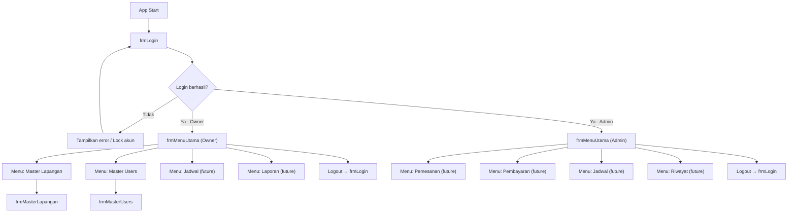
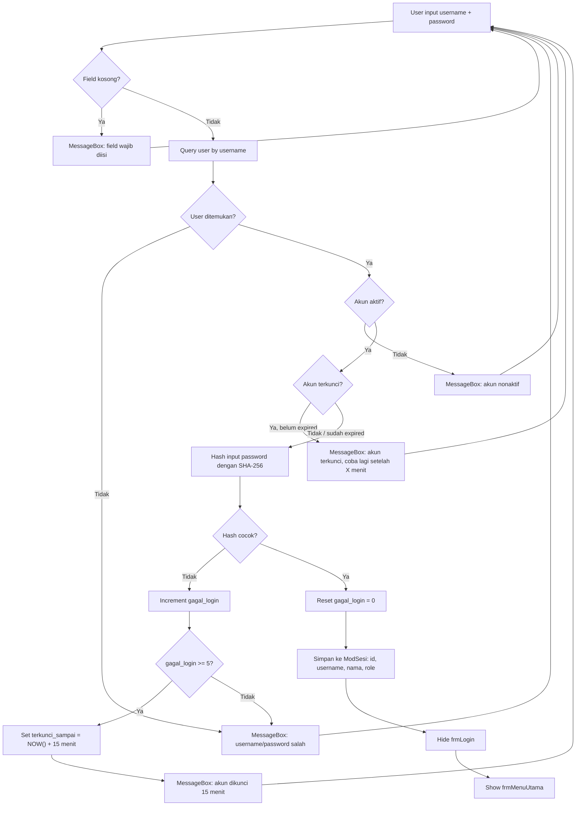
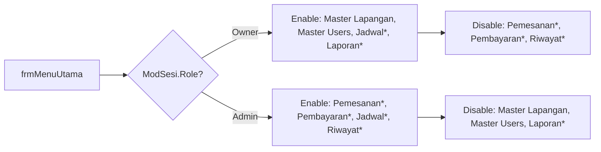
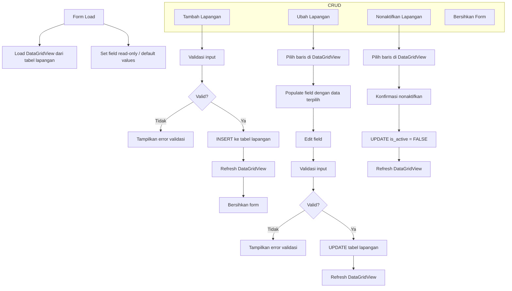
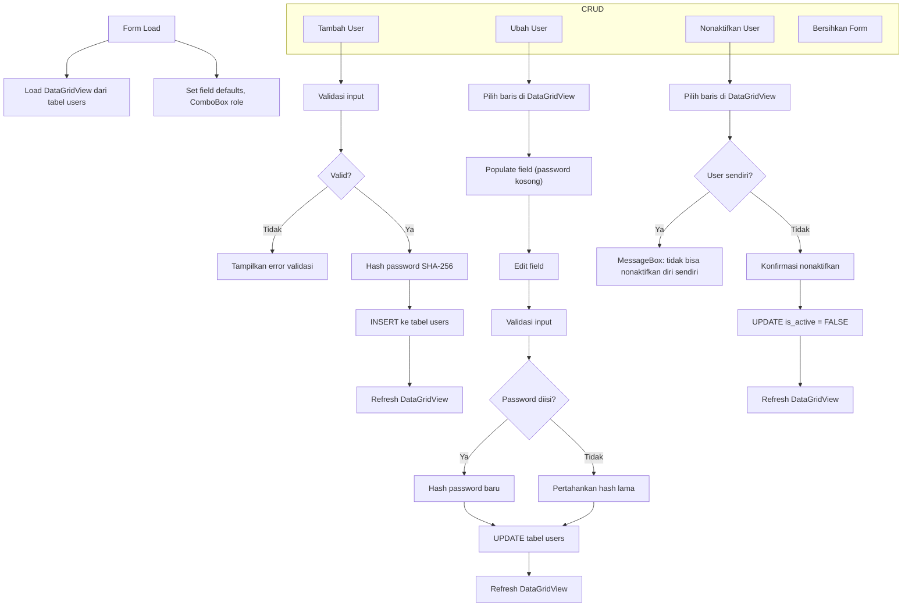
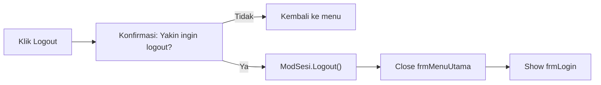

# APP-FLOW — Application Flow

> **Versi**: 1.0 — Week 10 Deliverable  
> **Tanggal**: 4 November 2026

---

## 1. Alur Utama Aplikasi (Week 10)

---

## 2. Alur Login (`frmLogin`)

### Detail Validasi Login

| Step | Validasi | Aksi Gagal |
|------|----------|-----------|
| 1 | Username dan password tidak boleh kosong | MessageBox warning |
| 2 | Cari user berdasarkan username (case-insensitive) | "Username atau password salah" |
| 3 | Cek `is_active = TRUE` | "Akun tidak aktif, hubungi Owner" |
| 4 | Cek `terkunci_sampai` < NOW() atau NULL | "Akun terkunci, coba lagi setelah X menit" |
| 5 | Bandingkan SHA-256 hash | "Username atau password salah" + increment gagal |
| 6 | Jika `gagal_login >= 5` → kunci 15 menit | Set `terkunci_sampai` |
| 7 | Login berhasil → reset `gagal_login`, set session | Redirect ke Menu Utama |

---

## 3. Alur Menu Utama (`frmMenuUtama`)

> *Bertanda asterisk (\*) = form belum dibuat di Week 10, menu tampil tapi disabled/placeholder*

### Menu Mapping

| Menu Item | Owner | Admin | Form Target | Status Week 10 |
|-----------|-------|-------|-------------|----------------|
| Master Lapangan | ✅ Enabled | ❌ Disabled | `frmMasterLapangan` | ✅ Implementasi |
| Master Users | ✅ Enabled | ❌ Disabled | `frmMasterUsers` | ✅ Implementasi |
| Pemesanan | ❌ Disabled | ✅ Enabled | `frmPemesanan` | ⏳ Future |
| Pembayaran | ❌ Disabled | ✅ Enabled | `frmPembayaran` | ⏳ Future |
| Jadwal | ✅ Enabled | ✅ Enabled | `frmJadwal` | ⏳ Future |
| Laporan | ✅ Enabled | ❌ Disabled | `frmLaporan` | ⏳ Future |
| Riwayat | ❌ Disabled | ✅ Enabled | `frmLaporan` | ⏳ Future |
| Logout | ✅ Enabled | ✅ Enabled | → `frmLogin` | ✅ Implementasi |

---

## 4. Alur CRUD Master Lapangan (`frmMasterLapangan`)

### Validasi Master Lapangan

| Field | Validasi | Pesan Error |
|-------|----------|-------------|
| Nama Lapangan | Wajib diisi, unik | "Nama lapangan wajib diisi" / "Nama lapangan sudah ada" |
| Jenis Lantai | Wajib diisi | "Jenis lantai wajib diisi" |
| Harga per Jam | Wajib > 0 | "Harga per jam harus lebih dari 0" |

---

## 5. Alur CRUD Master Users (`frmMasterUsers`)

### Validasi Master Users

| Field | Validasi | Pesan Error |
|-------|----------|-------------|
| Username | Wajib diisi, min 4 karakter, unik | "Username wajib diisi" / "Username minimal 4 karakter" / "Username sudah digunakan" |
| Password | Wajib diisi saat tambah baru, min 6 karakter | "Password wajib diisi" / "Password minimal 6 karakter" |
| Nama Lengkap | Wajib diisi | "Nama lengkap wajib diisi" |
| Role | Wajib dipilih dari ComboBox | "Pilih role pengguna" |
| Nonaktifkan diri | Tidak boleh nonaktifkan akun sendiri | "Tidak dapat menonaktifkan akun Anda sendiri" |

---

## 6. Alur Logout

