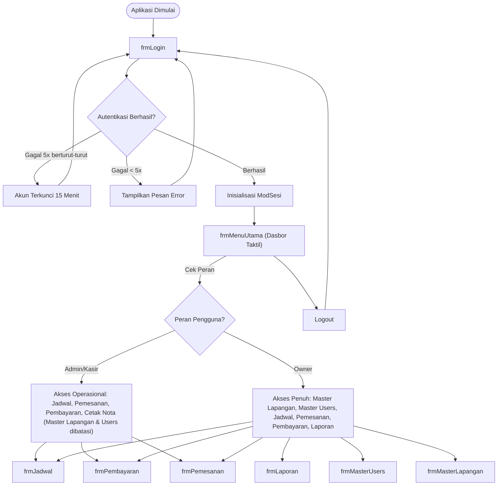
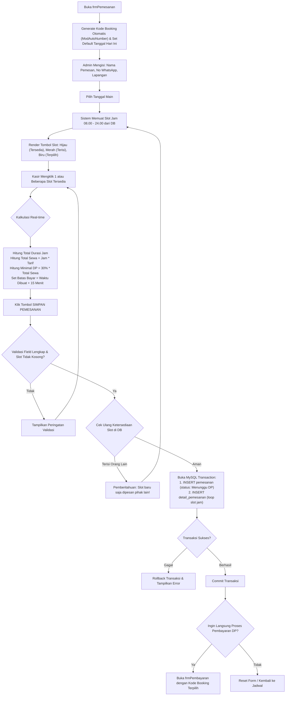
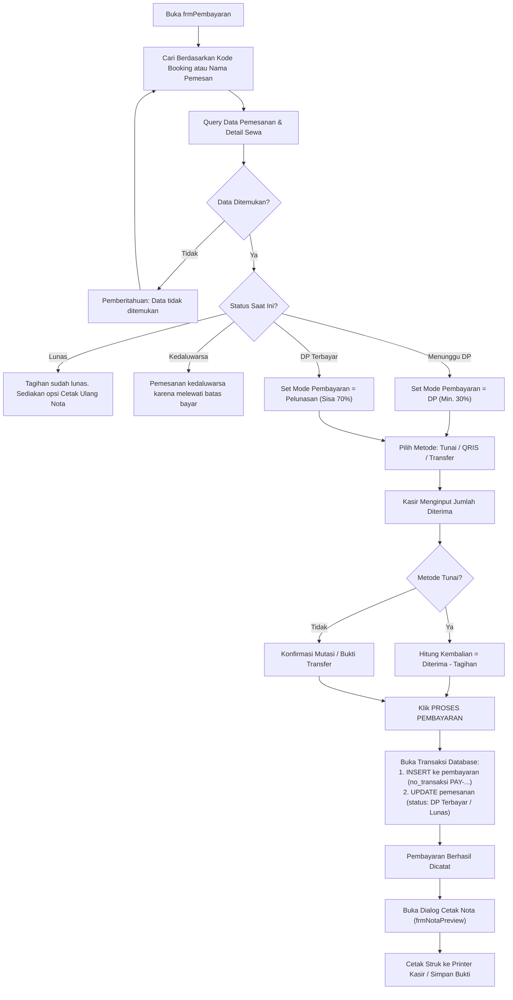
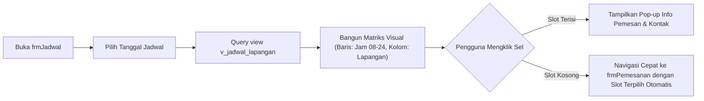
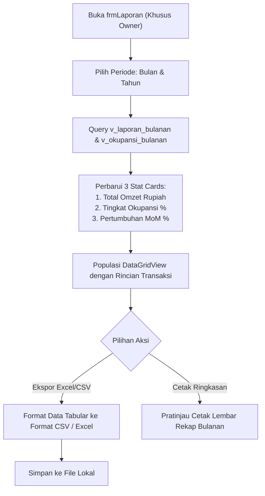
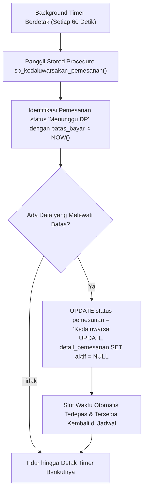

# APP-FLOW — Application Flow & User Journeys

> **Versi**: 2.1 — Full Operational Architecture  
> **Tanggal**: 5 November 2026  
> **Status**: Fase Operasional Inti Selesai (Fase 9 s.d. 15)

---

## 1. Alur Navigasi Utama Sistem

---

## 2. Alur Transaksi Pemesanan (`frmPemesanan`)

---

## 3. Alur Kasir & Pembayaran (`frmPembayaran`)

---

## 4. Alur Kalender Matriks Jadwal (`frmJadwal`)

---

## 5. Alur Laporan & Analitik Bisnis (`frmLaporan`)

---

## 6. Alur Background Maintenance (Auto-Expiration)

