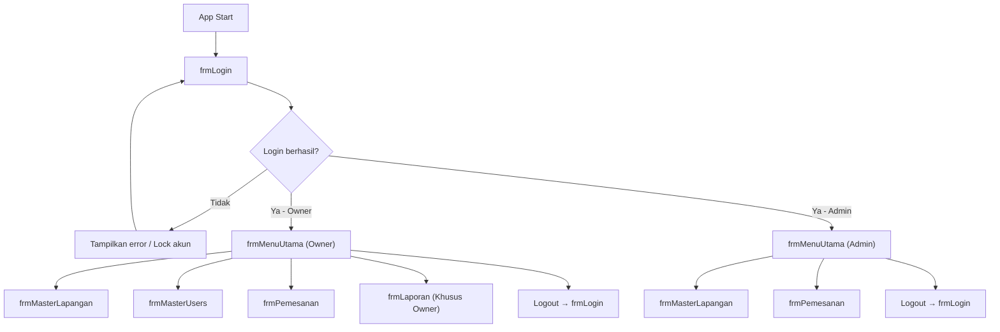
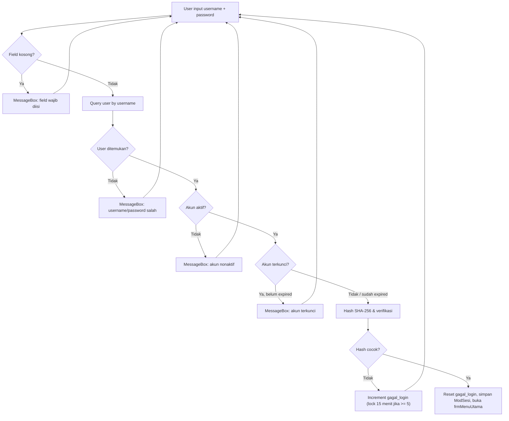
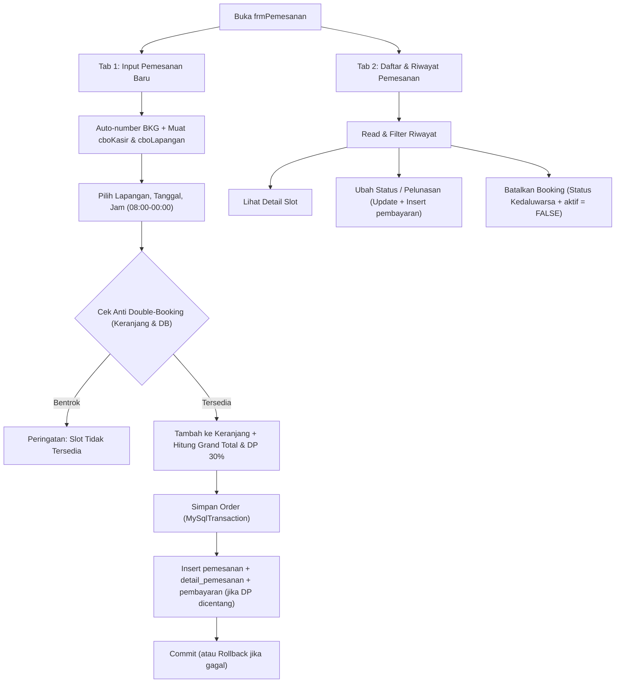
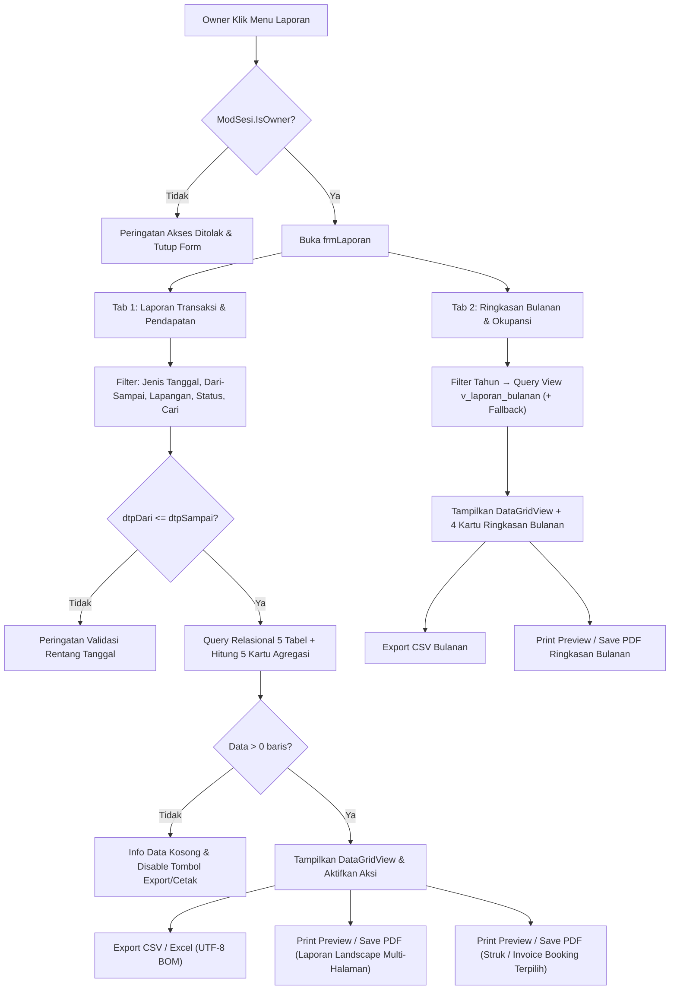

# APP-FLOW — Application Flow

> **Versi**: 1.2 — Week 10, Week 11, & Week 12 Deliverable  
> **Tanggal**: 18 November 2026

---

## 1. Alur Utama Aplikasi (Week 10 – Week 12)

---

## 2. Alur Login (`frmLogin`)

---

## 3. Alur Menu Utama (`frmMenuUtama`)

### Matriks Hak Akses Menu

| Menu Item | Owner | Admin | Form Target | Status Implementasi |
|---|:---:|:---:|---|---|
| Master Lapangan | ✅ Enabled | ✅ Enabled | `frmMasterLapangan` | ✅ Selesai (Week 10) |
| Master Users | ✅ Enabled | ❌ Disabled | `frmMasterUsers` | ✅ Selesai (Week 10) |
| Transaksi Pemesanan | ✅ Enabled | ✅ Enabled | `frmPemesanan` | ✅ Selesai (Week 11) |
| Laporan Pendapatan & Okupansi | ✅ Enabled | ❌ Disabled | `frmLaporan` | ✅ Selesai (Week 12) |
| Transaksi Pembayaran (Terpisah) | ⏳ Placeholder | ⏳ Placeholder | — | Terintegrasi di `frmPemesanan` |
| Kalender Jadwal Lapangan | ⏳ Placeholder | ⏳ Placeholder | — | Final Project |
| Keluar / Logout | ✅ Enabled | ✅ Enabled | → `frmLogin` | ✅ Selesai (Week 10) |

---

## 4. Alur Master Data (`frmMasterLapangan` & `frmMasterUsers`)

- **`frmMasterLapangan`**: Memuat ComboBox `jenis_lantai` dari DB → CRUD lengkap (Insert, Update, Soft Delete / Nonaktifkan, Hard Delete dengan cek FK `detail_pemesanan`, Clear, pencarian realtime).
- **`frmMasterUsers`**: Khusus Owner → CRUD akun dengan hash SHA-256, proteksi hapus akun yang sedang login, proteksi FK transaksi, sensor kolom `password_hash`, dan pencarian realtime.

---

## 5. Alur Transaksi Master-Detail (`frmPemesanan` — Week 11)

---

## 6. Alur Pelaporan Pendapatan & Okupansi (`frmLaporan` — Week 12)

