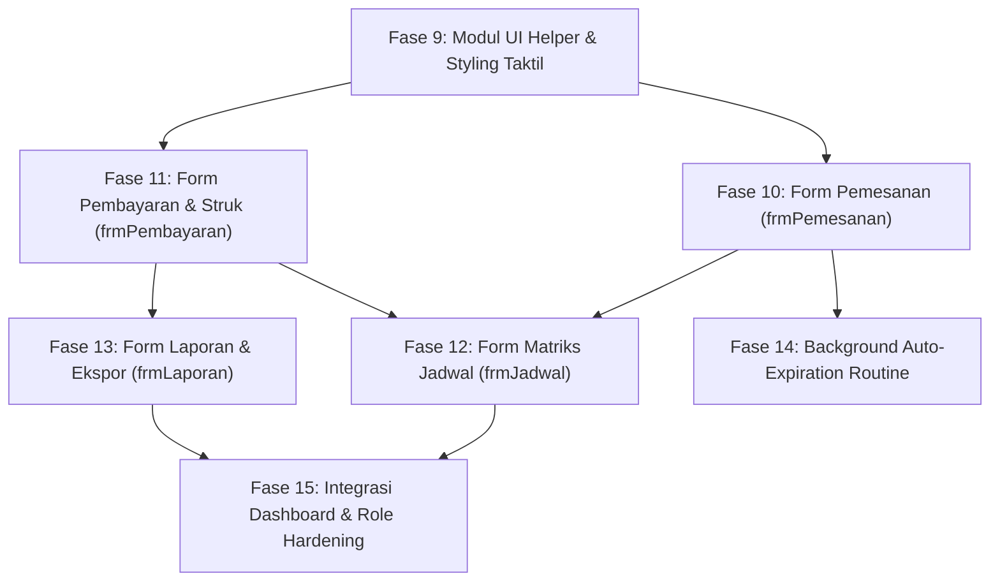

# IMPLEMENTATION-PLAN — Rencana Implementasi Sistem Operasional SIPELA

> **Versi**: 2.0 — Full Operational System Plan  
> **Tanggal**: 4 November 2026  
> **Status**: Perencanaan Sistem Penuh (Fase Baru di Atas, Arsip Week 10 Dikompresi di Bawah)

---

## 🛠️ Skills Terpasang & Panduan Penggunaan

Sesuai instruksi dan audit skill proyek, berikut adalah daftar skill yang terpasang di folder lokal `./.agents/skills/` dan akan digunakan selama tahapan implementasi:

1. **`dotnet-best-practices`** (Baru diinstal via `find-skills` dari `github/awesome-copilot`):
   - **Tujuan**: Memastikan penulisan kode VB.NET .NET 10 mengikuti kaidah arsitektur bersih, *resource management* (pembuangan koneksi database `Using ... End Using`, `Dispose`), optimasi *parameterized query*, dan penanganan memori UI form.
2. **`find-skills`** (`./.agents/skills/find-skills/`):
   - **Tujuan**: Menemukan dan memasang skill tambahan dari ekosistem open-agent jika diperlukan library atau perkakas pendukung baru di tengah pengembangan.
3. **`9router`** (`./.agents/skills/9router/`):
   - **Tujuan**: Gateway AI lokal/remote OpenAI-compatible jika nantinya dibutuhkan integrasi bantuan asisten teks otomatis, analisis teks ulasan, atau modul pelengkap.
4. **`herdr`** (`./.agents/skills/herdr/`):
   - **Tujuan**: Terminal multiplexer untuk mendelegasikan perintah terminal panjang/paralel bila diinstruksikan oleh pengguna.

---

## 🚀 Rencana Baru: Sistem Operasional Penuh (Fase 9 s.d. 15)

Tahapan berikut dirancang secara komprehensif untuk melengkapi seluruh sistem operasional **Arung Futsal** berbasis dokumen ADSI dan DFD 1 s.d. 3:

---

### Fase 9: UI Styling Helper Module (`ModUIHelper.vb`)

**Tujuan**: Mengimplementasikan standar desain **Tactile Claymorphism + Neo-Brutalism** ke seluruh kontrol Windows Forms melalui modul pembantu terpusat.

| # | Task | Detail Teknis | Status | File Output |
|---|------|---------------|--------|-------------|
| 9.1 | Skema Warna & Konstanta | Deklarasi warna hex resmi: `WarmCream (#FDFBF7)`, `CrispSlate (#2D334A)`, `MintGreen (#25C16F)`, `SkyBlue (#AED4E6)`, `Coral (#FFB5B5)`, `Lavender (#D8D4F2)` | [x] Selesai | `SIPELA/Modules/ModUIHelper.vb` |
| 9.2 | Styling Tombol Taktil | Subroutine `TerapkanGayaTombol(btn, tipe)`: set FlatStyle, BorderSize 2, FlatAppearance.BorderColor slate, dan event handler MouseEnter, MouseDown, MouseUp untuk efek kedalaman mekanis | [x] Selesai | ↑ |
| 9.3 | Styling DataGridView Taktil | Subroutine `TerapkanGayaGrid(dgv)`: set header slate gelap, alternating rows pastel lavender, selection sky blue, border tegas | [x] Selesai | ↑ |
| 9.4 | Styling Panel Card | Subroutine `TerapkanGayaCard(pnl)`: latar putih, border 2.5px slate ink, dan efek bayangan offset solid | [x] Selesai | ↑ |
| 9.5 | Styling Badge Pill | Helper untuk menggambar label berbentuk pill rounded dengan warna status yang sesuai | [x] Selesai | ↑ |

---

### Fase 10: Form Transaksi Pemesanan (`frmPemesanan`) & Slot Picker Engine

**Tujuan**: Memungkinkan kasir/admin mencatat pemesanan sewa lapangan dengan pemilihan slot visual jam 08.00–24.00, kalkulasi otomatis, dan pencegahan double-booking.

| # | Task | Detail Teknis | Status | File Output |
|---|------|---------------|--------|-------------|
| 10.1 | Designer UI | Layout 2 kolom: Panel pemesan kiri (nama, no. HP, tanggal, lapangan) + Visual Slot Selector kanan + Summary Card | [x] Selesai | `SIPELA/Forms/frmPemesanan.Designer.vb` |
| 10.2 | Auto Kode Booking | Integrasi `ModAutoNumber.AmbilNomorBerikutnya("BKG", tanggal)` menghasilkan format `BKG-YYYYMMDD-XXXX` | [x] Selesai | `SIPELA/Forms/frmPemesanan.vb` |
| 10.3 | Interactive Slot Grid | 16 tombol slot jam (08:00 s.d. 23:00) yang memuat status ketersediaan secara realtime berdasarkan tanggal dan lapangan terpilih | [x] Selesai | ↑ |
| 10.4 | Validasi Bentrok (Anti-Collision) | Cek tabel `detail_pemesanan` dengan constraint `uq_slot_aktif`. Blokir pemilihan slot yang sudah memiliki status aktif | [x] Selesai | ↑ |
| 10.5 | Auto-Calculation | Kalkulasi otomatis durasi sewa, `total_sewa = durasi * harga_per_jam`, dan `jumlah_dp = 30% * total_sewa` | [x] Selesai | ↑ |
| 10.6 | Batas Waktu Bayar | Atur `batas_bayar = NOW() + INTERVAL 15 MINUTE` | [x] Selesai | ↑ |
| 10.7 | Transaksi DB Atomik | Simpan header `pemesanan` dan baris-baris `detail_pemesanan` dalam satu `MySqlTransaction` | [x] Selesai | ↑ |

---

### Fase 11: Form Transaksi Pembayaran (`frmPembayaran`) & Generator Nota/Struk

**Tujuan**: Pemrosesan kasir untuk pembayaran DP dan Pelunasan dengan dukungan berbagai metode pembayaran, pembaruan status pemesanan, dan pencetakan bukti transaksi.

| # | Task | Detail Teknis | Status | File Output |
|---|------|---------------|--------|-------------|
| 11.1 | Designer UI | Panel pencarian kode booking, Card rincian tagihan (total sewa, status DP, sisa tagihan), Panel input pembayaran kasir | [x] Selesai | `SIPELA/Forms/frmPembayaran.Designer.vb` |
| 11.2 | Auto No Transaksi | Memanggil `ModAutoNumber.AmbilNomorBerikutnya("PAY", tanggal)` menghasilkan `PAY-YYYYMMDD-XXXX` | [x] Selesai | `SIPELA/Forms/frmPembayaran.vb` |
| 11.3 | Logika Jenis Bayar | Validasi jenis: Jika status 'Menunggu DP' → pilihan jenis DP (minimal 30%). Jika 'DP Terbayar' → pilihan jenis Pelunasan (sebesar sisa tagihan) | [x] Selesai | ↑ |
| 11.4 | Metode Pembayaran | Dukungan pilihan Tunai, QRIS, dan Transfer Bank. Perhitungan kembalian otomatis untuk pembayaran tunai | [x] Selesai | ↑ |
| 11.5 | Update Status Pemesanan | Eksekusi UPDATE status pemesanan menjadi 'DP Terbayar' atau 'Lunas' begitu record `pembayaran` berhasil disimpan | [x] Selesai | ↑ |
| 11.6 | Generator Struk / Nota | Dialog cetak struk taktil (`frmNotaPreview`) atau pencetakan via `System.Drawing.Printing.PrintDocument` | [x] Selesai | `SIPELA/Forms/frmNotaPreview.vb` |

---

### Fase 12: Form Visual Matriks Jadwal Lapangan (`frmJadwal`)

**Tujuan**: Memberikan visibilitas menyeluruh terhadap seluruh slot lapangan dalam format matriks waktu 08.00–24.00 per tanggal.

| # | Task | Detail Teknis | Status | File Output |
|---|------|---------------|--------|-------------|
| 12.1 | Designer UI | Date navigator bar (tombol Hari Ini, Prev, Next), Legend status (Hijau = Tersedia, Merah = Terisi, Kuning = Holding DP), Matriks grid container | [x] Selesai | `SIPELA/Forms/frmJadwal.Designer.vb` |
| 12.2 | Data Query Jadwal | Query data slot dari database menggunakan view `v_jadwal_lapangan` terfilter tanggal terpilih | [x] Selesai | `SIPELA/Forms/frmJadwal.vb` |
| 12.3 | Dynamic Matrix Rendering | Membuat kartu/sel slot secara dinamis per pertemuan kolom (lapangan) dan baris (slot jam) dengan warna status yang jelas | [x] Selesai | ↑ |
| 12.4 | Interaksi Klik Slot | Klik slot terisi → tampilkan pop-up ringkasan pemesan dan kontak; Klik slot kosong → navigasi cepat ke form pemesanan dengan slot terisi otomatis | [x] Selesai | ↑ |

---

### Fase 13: Form Laporan Pendapatan, Okupansi & Ekspor (`frmLaporan`)

**Tujuan**: Menyediakan data analitik pendapatan dan tingkat okupansi lapangan bagi Owner, dilengkapi ekspor data tabular.

| # | Task | Detail Teknis | Status | File Output |
|---|------|---------------|--------|-------------|
| 13.1 | Designer UI | Filter bulan & tahun, 3 Stat Cards (Total Pendapatan, Okupansi %, MoM Growth), DataGridView rincian, Tombol ekspor | [x] Selesai | `SIPELA/Forms/frmLaporan.Designer.vb` |
| 13.2 | Query View Analitik | Menampilkan data dari view `v_laporan_bulanan`, `v_pendapatan_bulanan`, dan `v_okupansi_bulanan` | [x] Selesai | `SIPELA/Forms/frmLaporan.vb` |
| 13.3 | Perhitungan Okupansi | Menghitung persentase: `(Total Slot Terpakai / (Jumlah Lapangan * 16 Jam * Hari Dalam Bulan)) * 100%` | [x] Selesai | ↑ |
| 13.4 | Ekspor ke CSV / Excel | Fungsi pembuatan file spreadsheet CSV/Excel terformat tanpa ketergantungan COM eksternal yang rapuh | [x] Selesai | ↑ |
| 13.5 | Pratinjau Cetak Laporan | Fitur cetak ringkasan laporan bulanan resmi untuk arsip fisik pemilik | [x] Selesai | ↑ |

---

### Fase 14: Background Routine Maintenance (Auto-Expiration)

**Tujuan**: Menjalankan pengecekan otomatis pemesanan yang telah melewati `batas_bayar` (15 menit) agar slot lapangan otomatis dibebaskan kembali.

| # | Task | Detail Teknis | Status | File Output |
|---|------|---------------|--------|-------------|
| 14.1 | Timer Otomatis | Menambahkan komponen `Timer` di latar belakang form utama yang berdetak setiap 30-60 detik | [x] Selesai | `SIPELA/Forms/frmMenuUtama.vb` |
| 14.2 | Eksekusi Stored Procedure | Memanggil `CALL sp_kedaluwarsakan_pemesanan()` secara asinkron dalam background task tanpa freeze UI | [x] Selesai | ↑ |
| 14.3 | Notifikasi Pelepasan Slot | Eksekusi pelepasan slot aktif dan update status pemesanan kedaluwarsa secara berkala | [x] Selesai | ↑ |

---

### Fase 15: Integrasi Dashboard & Role Hardening

**Tujuan**: Menyambungkan seluruh tombol di `frmMenuUtama` ke form-form baru, memperbarui metrik realtime di dashboard, dan memastikan hak akses Admin vs Owner terjaga ketat.

| # | Task | Detail Teknis | File Output |
|---|------|---------------|-------------|
| 15.1 | Wiring Event Tombol | Mengganti dialog "Fitur Mendatang" di `frmMenuUtama` dengan pembukaan form riil (`frmPemesanan`, `frmPembayaran`, `frmJadwal`, `frmLaporan`) | `SIPELA/Forms/frmMenuUtama.vb` |
| 15.2 | Dynamic Stat Cards | Menampilkan data riil di 4 stat card menu utama (Booking Hari Ini, Pending DP, Pendapatan Bulan Ini) | ↑ |
| 15.3 | Penerapan Gaya Taktil Baru | Terapkan `ModUIHelper` pada `frmLogin`, `frmMenuUtama`, `frmMasterLapangan`, dan `frmMasterUsers` agar konsisten | Seluruh form |
| 15.4 | Verifikasi Kompilasi & Build | `dotnet build` solusi untuk memastikan 0 warning dan 0 error | `SIPELA/SIPELA.vbproj` |

---

### 📌 Catatan Khusus: Fitur Masa Depan (Post-MVP / Roadmap Lanjutan)
- **Modul Open Sparring (`frmOpenSparring`)**:
  - DFD Level 0 (Proses 4.0) mencakup fitur *Kelola Open Sparring* untuk mempertemukan tim yang kekurangan lawan.
  - Sesuai arahan pengguna, fitur ini dicatat (*taken-note*) untuk dikembangkan pada iterasi setelah 5 fitur operasional inti di atas selesai dan berjalan penuh.

---

## 📦 Arsip Historis: Fase 1 s.d. 8 (Week 10 Deliverable — Selesai)

<strong>Klik untuk melihat detail Fase 1 s.d. 8 yang telah selesai diimplementasikan</strong>

### Ringkasan Pencapaian Week 10
Seluruh fondasi dasar aplikasi telah selesai dibangun, terkompilasi bersih dengan .NET 10 dan MySQL:
- **Fase 1 (Project Setup)**: Pembuatan solusi VB.NET .NET 10 Windows Forms (`SIPELA.slnx`, `SIPELA.vbproj`).
- **Fase 2 (Database SQL Script)**: Skrip lengkap `Database/arung_futsal.sql` (6 tabel, 2 stored procedures, 4 views, seed data).
- **Fase 3 (NuGet Package)**: Pemasangan connector resmi `MySql.Data` v26.10.0.
- **Fase 4 (Business Logic Modules)**: `ModKoneksi.vb`, `ModSesi.vb`, `ModErrorHandler.vb`, dan `ModAutoNumber.vb`.
- **Fase 5 (Form Login - `frmLogin`)**: Autentikasi hash SHA-256 dan perlindungan brute-force lock 5 kali gagal.
- **Fase 6 (Form Menu Utama - `frmMenuUtama`)**: Shell navigasi dasbor dengan pemisahan peran (*role-based access*) Admin dan Owner.
- **Fase 7 (Form Master Lapangan - `frmMasterLapangan`)**: CRUD data lapangan, pencegahan duplikasi, pencarian instan, dan soft delete.
- **Fase 8 (Form Master Users - `frmMasterUsers`)**: CRUD pengguna kasir/admin oleh Owner, proteksi penghapusan diri sendiri, dan enkripsi password.

