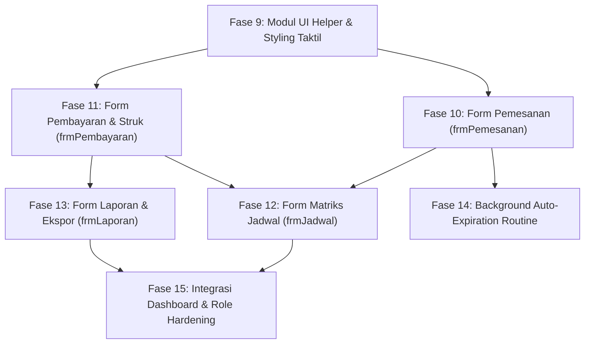

# IMPLEMENTATION-PLAN — Rencana Implementasi Sistem Operasional SIPELA

> **Versi**: 2.1 — Fase 9 s.d. 15 Selesai  
> **Tanggal**: 5 November 2026  
> **Status**: Seluruh Fase Operasional Inti Selesai • 1 Bug Fix Analitik Terbuka

---

## 🛠️ Skills Terpasang & Panduan Penggunaan

Sesuai instruksi dan audit skill proyek, berikut adalah daftar skill yang terpasang di folder lokal `./.agents/skills/` dan akan digunakan selama tahapan implementasi:

1. **`dotnet-best-practices`** (diinstal via `find-skills` dari `github/awesome-copilot`):
   - **Tujuan**: Memastikan penulisan kode VB.NET .NET 10 mengikuti kaidah arsitektur bersih, *resource management* (pembuangan koneksi database `Using ... End Using`, `Dispose`), optimasi *parameterized query*, dan penanganan memori UI form.
2. **`find-skills`** (`./.agents/skills/find-skills/`):
   - **Tujuan**: Menemukan dan memasang skill tambahan dari ekosistem open-agent jika diperlukan library atau perkakas pendukung baru di tengah pengembangan.
3. **`9router`** (`./.agents/skills/9router/`):
   - **Tujuan**: Gateway AI lokal/remote OpenAI-compatible jika nantinya dibutuhkan integrasi bantuan asisten teks otomatis, analisis teks ulasan, atau modul pelengkap.
4. **`herdr`** (`./.agents/skills/herdr/`):
   - **Tujuan**: Terminal multiplexer untuk mendelegasikan perintah terminal panjang/paralel bila diinstruksikan oleh pengguna.

---

## 🚨 Bagian Pending: Bug Fix & Pekerjaan Berikutnya

> Semua fase operasional inti (Fase 9 s.d. 15) telah selesai. Bagian ini berisi satu-satunya bug fix yang masih terbuka beserta rencana pengembangan masa depan.

### Bug Fix Prioritas: BUG-001 — Laporan Analitik Gagal `only_full_group_by`

| Field | Detail |
|-------|--------|
| **Status** | 🔴 Terbuka — Belum Dikerjakan (dilewati sementara atas arahan pengguna, 5 Nov 2026) |
| **Gejala** | Buka `frmLaporan` → dialog *Kesalahan Sistem*: `Memuat data laporan analitik: Expression #3 of SELECT list is not in GROUP BY clause and contains nonaggregated column 'arung_futsal.dp.tanggal_main' which is not functionally dependent on columns in GROUP BY clause; this is incompatible with sql_mode=only_full_group_by` |
| **File tersangkut** | `Database/arung_futsal.sql` (view `v_okupansi_bulanan`, baris ±209–219) dan `Database/migration_v2_views_procedures.sql` (baris ±54–62) |
| **Root cause** | Di view `v_okupansi_bulanan`, expression #3 `kapasitas_slot` (dan #4 `persen_okupansi`) memakai `DAY(LAST_DAY(dp.tanggal_main))`. Kolom non-agregat `dp.tanggal_main` tidak tercakup oleh `GROUP BY DATE_FORMAT(dp.tanggal_main, '%Y-%m'), LAST_DAY(dp.tanggal_main)`, sehingga melanggar `sql_mode=only_full_group_by` (bawaan MySQL 8.0+). Query diteruskan ke `v_laporan_bulanan` → `frmLaporan` saat memuat jenis laporan "Ringkasan Bulanan (MoM)". |
| **Arah fix** | Terapkan di **kedua** file SQL (master + migration) lalu jalankan ulang `CREATE OR REPLACE VIEW`:   1) Bungkus ekspresi pengguna `dp.tanggal_main` dengan agregat: `MAX(DAY(LAST_DAY(dp.tanggal_main)))` dan `MAX(dp.tanggal_main)`, atau   2) Tambahkan `dp.tanggal_main` / ekspresi lengkap ke klausa `GROUP BY`, atau   3) Hitung kapasitas bulan tanpa membaca kolom langsung: `LAST_DAY(CONCAT(DATE_FORMAT(dp.tanggal_main, '%Y-%m'), '-01'))`. |
| **Langkah verifikasi** | Setelah fix: jalankan ulang `Database/migration_v2_views_procedures.sql`, lalu buka `frmLaporan` → jenis **Ringkasan Bulanan** harus tampil tanpa error dan ketiga kartu analitik terisi. |
| **Catatan** | Error hanya terjadi pada jenis laporan *Ringkasan Bulanan (MoM)* karena hanya jalur itu yang membaca `v_okupansi_bulanan` via `v_laporan_bulanan`. Jenis laporan lain (Rincian Transaksi & Rincian Pemesanan) tidak tersangkut. |

### Roadmap Masa Depan (Post-MVP)

- **Modul Open Sparring (`frmOpenSparring`)**:
  - DFD Level 0 (Proses 4.0) mencakup fitur *Kelola Open Sparring* untuk mempertemukan tim yang kekurangan lawan.
  - Dicatat (*taken-note*) untuk dikembangkan pada iterasi setelah 5 fitur operasional inti selesai dan berjalan penuh.

---

## 🎯 Ringkasan Pencapaian: Fase 9 s.d. 15 (Selesai)

Seluruh modul operasional inti sistem kasir & pemesanan digital telah rampung dan terkompilasi bersih:

- **Fase 9**: Engine styling taktil `ModUIHelper.vb` (warna resmi, tombol, grid, card, badge pill) selesai.
- **Fase 10**: `frmPemesanan` — kode `BKG-YYYYMMDD-XXXX`, slot picker 08.00–23.00, anti double-booking via `uq_slot_aktif`, kalkulasi otomatis total + DP 30%, batas bayar 15 menit, transaksi DB atomik.
- **Fase 11**: `frmPembayaran` — kode `PAY-YYYYMMDD-XXXX`, jenis DP/Pelunasan, metode Tunai/QRIS/Transfer, update status otomatis, cetak struk via `frmNotaPreview`.
- **Fase 12**: `frmJadwal` — matriks slot visual dari `v_jadwal_lapangan`, legend warna status, klik slot → detail pemesan / navigasi cepat pemesanan.
- **Fase 13**: `frmLaporan` — filter bulan/tahun, 3 kartu analitik (Omzet, Okupansi, MoM), ekspor CSV UTF-8 BOM, cetak rekap. *(Terbuka bug BUG-001 — lihat bagian pending.)*
- **Fase 14**: Timer background `frmMenuUtama` → `CALL sp_kedaluwarsakan_pemesanan()` untuk auto-release slot melewati batas bayar.
- **Fase 15**: Wiring seluruh tombol menu ke form riil, 4 stat card dinamis (Total Lapangan, Booking Hari Ini, Menunggu DP, Pendapatan Bulan Ini), penerapan `ModUIHelper` menyeluruh, `dotnet build` 0 warning 0 error.

---

## 📦 Arsip Historis: Fase 1 s.d. 15 (Deliverable Selesai)

<strong>Klik untuk melihat ringkasan Fase 1 s.d. 8 yang telah selesai diimplementasikan</strong>

### Ringkasan Pencapaian Week 10
Seluruh fondasi dasar aplikasi telah selesai dibangun, terkompilasi bersih dengan .NET 10 dan MySQL:
- **Fase 1 (Project Setup)**: Pembuatan solusi VB.NET .NET 10 Windows Forms (`SIPELA.slnx`, `SIPELA.vbproj`).
- **Fase 2 (Database SQL Script)**: Skrip lengkap `Database/arung_futsal.sql` (6 tabel, 2 stored procedures, 4 views, seed data).
- **Fase 3 (NuGet Package)**: Pemasangan connector resmi `MySql.Data` v26.10.0.
- **Fase 4 (Business Logic Modules)**: `ModKoneksi.vb`, `ModSesi.vb`, `ModErrorHandler.vb`, dan `ModAutoNumber.vb`.
- **Fase 5 (Form Login - `frmLogin`)**: Autentikasi hash SHA-256 dan perlindungan brute-force lock 5 kali gagal.
- **Fase 6 (Form Menu Utama - `frmMenuUtama`)**: Shell navigasi dasbor dengan pemisahan peran (*role-based access*) Admin dan Owner.
- **Fase 7 (Form Master Lapangan - `frmMasterLapangan`)**: CRUD data lapangan, pencegahan duplikasi, pencarian instan, dan soft delete.
- **Fase 8 (Form Master Users - `frmMasterUsers`)**: CRUD pengguna kasir/admin oleh Owner, proteksi penghapusan diri sendiri, dan enkripsi password.

<strong>Klik untuk melihat rincian teknis Fase 9 s.d. 15 (Selesai, 5 Nov 2026)</strong>

### Fase 9: UI Styling Helper Module (`ModUIHelper.vb`)
| # | Task | Detail Teknis | File Output |
|---|------|---------------|-------------|
| 9.1 | Skema Warna & Konstanta | Warna hex resmi: `WarmCream (#FDFBF7)`, `CrispSlate (#2D334A)`, `MintGreen (#25C16F)`, `SkyBlue (#AED4E6)`, `Coral (#FFB5B5)`, `Lavender (#D8D4F2)` | `SIPELA/Modules/ModUIHelper.vb` |
| 9.2 | Styling Tombol Taktil | `TerapkanGayaTombol(btn, tipe)`: FlatStyle, BorderSize 2, FlatAppearance.BorderColor slate, event MouseEnter/MouseDown/MouseUp efek kedalaman | ↑ |
| 9.3 | Styling DataGridView Taktil | `TerapkanGayaGrid(dgv)`: header slate gelap, alternating rows pastel lavender, selection sky blue, border tegas | ↑ |
| 9.4 | Styling Panel Card | `TerapkanGayaCard(pnl)`: latar putih, border 2.5px slate ink, bayangan offset solid | ↑ |
| 9.5 | Styling Badge Pill | Helper label berbentuk pill rounded dengan warna status | ↑ |

### Fase 10: Form Transaksi Pemesanan (`frmPemesanan`) & Slot Picker Engine
| # | Task | Detail Teknis | File Output |
|---|------|---------------|-------------|
| 10.1 | Designer UI | Layout 2 kolom: panel pemesan kiri (nama, no. HP, tanggal, lapangan) + Visual Slot Selector kanan + Summary Card | `SIPELA/Forms/frmPemesanan.Designer.vb` |
| 10.2 | Auto Kode Booking | `ModAutoNumber.AmbilNomorBerikutnya("BKG", tanggal)` → format `BKG-YYYYMMDD-XXXX` | `SIPELA/Forms/frmPemesanan.vb` |
| 10.3 | Interactive Slot Grid | 16 tombol slot jam (08.00 s.d. 23.00) status ketersediaan realtime per tanggal & lapangan | ↑ |
| 10.4 | Validasi Bentrok (Anti-Collision) | Cek `detail_pemesanan` dengan constraint `uq_slot_aktif`; blokir slot berstatus aktif | ↑ |
| 10.5 | Auto-Calculation | `total_sewa = durasi * harga_per_jam`, `jumlah_dp = 30% * total_sewa` | ↑ |
| 10.6 | Batas Waktu Bayar | `batas_bayar = NOW() + INTERVAL 15 MINUTE` | ↑ |
| 10.7 | Transaksi DB Atomik | Simpan header `pemesanan` + baris `detail_pemesanan` dalam satu `MySqlTransaction` | ↑ |

### Fase 11: Form Transaksi Pembayaran (`frmPembayaran`) & Generator Nota/Struk
| # | Task | Detail Teknis | File Output |
|---|------|---------------|-------------|
| 11.1 | Designer UI | Panel pencarian kode booking, Card rincian tagihan, Panel input pembayaran kasir | `SIPELA/Forms/frmPembayaran.Designer.vb` |
| 11.2 | Auto No Transaksi | `ModAutoNumber.AmbilNomorBerikutnya("PAY", tanggal)` → `PAY-YYYYMMDD-XXXX` | `SIPELA/Forms/frmPembayaran.vb` |
| 11.3 | Logika Jenis Bayar | 'Menunggu DP' → jenis DP (min. 30%); 'DP Terbayar' → jenis Pelunasan (sisa tagihan) | ↑ |
| 11.4 | Metode Pembayaran | Tunai, QRIS, Transfer Bank; kembalian otomatis untuk tunai | ↑ |
| 11.5 | Update Status Pemesanan | UPDATE status → 'DP Terbayar' / 'Lunas' setelah record `pembayaran` tersimpan | ↑ |
| 11.6 | Generator Struk / Nota | Dialog cetak struk taktil (`frmNotaPreview`) / `PrintDocument` | `SIPELA/Forms/frmNotaPreview.vb` |

### Fase 12: Form Visual Matriks Jadwal Lapangan (`frmJadwal`)
| # | Task | Detail Teknis | File Output |
|---|------|---------------|-------------|
| 12.1 | Designer UI | Date navigator (Hari Ini, Prev, Next), Legend status (Hijau Tersedia / Merah Terisi / Kuning Holding DP), container matriks | `SIPELA/Forms/frmJadwal.Designer.vb` |
| 12.2 | Data Query Jadwal | Query view `v_jadwal_lapangan` terfilter tanggal terpilih | `SIPELA/Forms/frmJadwal.vb` |
| 12.3 | Dynamic Matrix Rendering | Kartu slot dinamis per kolom (lapangan) × baris (jam) dengan warna status | ↑ |
| 12.4 | Interaksi Klik Slot | Slot terisi → pop-up ringkasan pemesan & kontak; slot kosong → navigasi cepat ke `frmPemesanan` | ↑ |

### Fase 13: Form Laporan Pendapatan, Okupansi & Ekspor (`frmLaporan`)
| # | Task | Detail Teknis | File Output |
|---|------|---------------|-------------|
| 13.1 | Designer UI | Filter bulan & tahun, 3 Stat Cards (Omzet, Okupansi %, MoM), DataGridView rincian, tombol ekspor | `SIPELA/Forms/frmLaporan.Designer.vb` |
| 13.2 | Query View Analitik | Data dari `v_laporan_bulanan`, `v_pendapatan_bulanan`, `v_okupansi_bulanan` | `SIPELA/Forms/frmLaporan.vb` |
| 13.3 | Perhitungan Okupansi | `(Total Slot Terpakai / (Jumlah Lapangan * 16 Jam * Hari Dalam Bulan)) * 100%` | ↑ |
| 13.4 | Ekspor ke CSV / Excel | File CSV UTF-8 BOM tanpa ketergantungan COM eksternal | ↑ |
| 13.5 | Pratinjau Cetak Laporan | Cetak ringkasan laporan bulanan resmi untuk arsip fisik | ↑ |

> ⚠️ **Terkait BUG-001**: Task 13.2/13.3 menampilkan error `only_full_group_by` pada view `v_okupansi_bulanan` saat memuat Ringkasan Bulanan. Rincian & arah fix ada di bagian **Pending** di atas.

### Fase 14: Background Routine Maintenance (Auto-Expiration)
| # | Task | Detail Teknis | File Output |
|---|------|---------------|-------------|
| 14.1 | Timer Otomatis | Komponen `Timer` background di form utama berdetak 30–60 detik | `SIPELA/Forms/frmMenuUtama.vb` |
| 14.2 | Eksekusi Stored Procedure | `CALL sp_kedaluwarsakan_pemesanan()` asinkron tanpa freeze UI | ↑ |
| 14.3 | Notifikasi Pelepasan Slot | Status pemesanan kedaluwarsa + slot `aktif = NULL` otomatis berkala | ↑ |

### Fase 15: Integrasi Dashboard & Role Hardening
| # | Task | Detail Teknis | File Output |
|---|------|---------------|-------------|
| 15.1 | Wiring Event Tombol | Buka form riil (`frmPemesanan`, `frmPembayaran`, `frmJadwal`, `frmLaporan`) menggantikan dialog "Fitur Mendatang" | `SIPELA/Forms/frmMenuUtama.vb` |
| 15.2 | Dynamic Stat Cards | 4 stat card dinamis: **Total Lapangan**, **Booking Hari Ini**, **Menunggu DP**, **Pendapatan Bulan Ini** | ↑ |
| 15.3 | Penerapan Gaya Taktil Baru | `ModUIHelper` pada `frmLogin`, `frmMenuUtama`, `frmMasterLapangan`, `frmMasterUsers` | Seluruh form |
| 15.4 | Verifikasi Kompilasi & Build | `dotnet build` solusi: 0 warning dan 0 error | `SIPELA/SIPELA.vbproj` |

