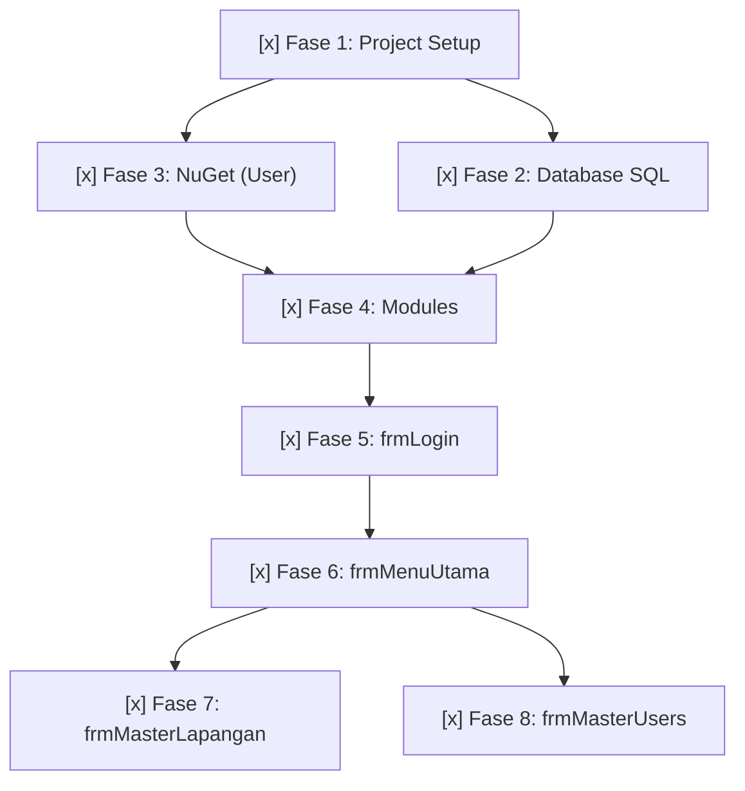

# IMPLEMENTATION-PLAN — Rencana Implementasi

> **Versi**: 1.0 — Week 10 Deliverable  
> **Tanggal**: 4 November 2026  
> **Status**: Selesai Diimplementasikan (Menunggu Eksekusi Script SQL & Run Testing oleh Pengguna)

---

## Ringkasan

Total **8 fase**, diurutkan berdasarkan dependensi. Seluruh fase 1 s.d. 8 telah berhasil diimplementasikan dan diverifikasi dengan `dotnet build` tanpa error.

---

## Fase 1: Project Setup

**Tujuan**: Buat project VB.NET Windows Forms .NET 10

| # | Task | Detail | Status | File Output |
|---|------|--------|--------|-------------|
| 1.1 | Buat solution dan project | Solusi & WinForms .NET 10 VB.NET | [x] Selesai | `SIPELA/SIPELA.slnx`, `SIPELA/SIPELA.vbproj` |
| 1.2 | Buat folder struktur | Buat `Forms/`, `Modules/` di dalam folder project | [x] Selesai | Folder `Forms/`, `Modules/` |
| 1.3 | Konfigurasi `.vbproj` | Target `net10.0-windows`, `WinExe`, `UseWindowsForms` | [x] Selesai | `SIPELA/SIPELA.vbproj` |

**Checkpoint**: `dotnet build` berhasil tanpa error. [x]

---

## Fase 2: Database — SQL Script

**Tujuan**: Buat skrip SQL lengkap untuk database `arung_futsal`

| # | Task | Detail | Status | File Output |
|---|------|--------|--------|-------------|
| 2.1 | CREATE DATABASE | `CREATE DATABASE IF NOT EXISTS arung_futsal` | [x] Selesai | `Database/arung_futsal.sql` |
| 2.2 | Tabel `users` | Lengkap dengan PK, UNIQUE, DEFAULT, CHECK | [x] Selesai | ↑ |
| 2.3 | Tabel `lapangan` | Lengkap dengan PK, UNIQUE, DEFAULT, CHECK | [x] Selesai | ↑ |
| 2.4 | Tabel `pemesanan` | Lengkap dengan FK, ENUM, CHECK | [x] Selesai | ↑ |
| 2.5 | Tabel `detail_pemesanan` | Lengkap dengan FK, UNIQUE composite slot, CHECK | [x] Selesai | ↑ |
| 2.6 | Tabel `pembayaran` | Lengkap dengan FK, UNIQUE composite, ENUM, CHECK | [x] Selesai | ↑ |
| 2.7 | Tabel `penomoran` | Composite PK, DEFAULT | [x] Selesai | ↑ |
| 2.8 | Stored Procedure `sp_nomor_berikutnya` | INSERT ON DUPLICATE KEY UPDATE, atomik | [x] Selesai | ↑ |
| 2.9 | Stored Procedure `sp_kedaluwarsakan_pemesanan` | Update status expired | [x] Selesai | ↑ |
| 2.10 | Views (4 views) | `v_jadwal_lapangan`, `v_pendapatan_bulanan`, `v_okupansi_bulanan`, `v_laporan_bulanan` | [x] Selesai | ↑ |
| 2.11 | Sample Data | 2 users (owner, admin hash SHA-256) + 3 lapangan dummy | [x] Selesai | ↑ |

**Checkpoint**: Skrip SQL siap dijalankan oleh pengguna di MySQL server lokal. [x]

---

## Fase 3: NuGet Package

**Tujuan**: Install MySql.Data connector

| # | Task | Detail | Status | File Output |
|---|------|--------|--------|-------------|
| 3.1 | Install `MySql.Data` | Terpasang `MySql.Data` v26.10.0 pada `SIPELA.vbproj` | [x] Selesai | `SIPELA/SIPELA.vbproj` |

**Checkpoint**: `dotnet build` berhasil dengan `MySql.Data` terpasang. [x]

---

## Fase 4: Modules — Business Logic Layer

**Tujuan**: Buat 4 module pendukung

| # | Task | Detail | Status | File Output |
|---|------|--------|--------|-------------|
| 4.1 | `ModKoneksi.vb` | Connection string, `BukaKoneksi()`, `TestKoneksi()`, error handling koneksi | [x] Selesai | `SIPELA/Modules/ModKoneksi.vb` |
| 4.2 | `ModSesi.vb` | Property: IdUser, Username, NamaLengkap, Role. Method: Logout() | [x] Selesai | `SIPELA/Modules/ModSesi.vb` |
| 4.3 | `ModErrorHandler.vb` | `TampilkanError()`, `TampilkanPeringatan()`, `TampilkanInfo()`, `Konfirmasi()`, logging ke file | [x] Selesai | `SIPELA/Modules/ModErrorHandler.vb` |
| 4.4 | `ModAutoNumber.vb` | `AmbilNomorBerikutnya()` memanggil `sp_nomor_berikutnya`, `BuatKodeOtomatis()` | [x] Selesai | `SIPELA/Modules/ModAutoNumber.vb` |

**Checkpoint**: `dotnet build` berhasil dan modul siap diakses dari seluruh form. [x]

---

## Fase 5: Form Login (`frmLogin`)

**Tujuan**: Form autentikasi dengan SHA-256 hashing dan proteksi brute force

| # | Task | Detail | Status | File Output |
|---|------|--------|--------|-------------|
| 5.1 | Designer | Layout 420×345, TextBox user & pass, btnLogin, btnKeluar, lblStatus | [x] Selesai | `SIPELA/Forms/frmLogin.Designer.vb` |
| 5.2 | Logic — Validasi field | Cek username dan password tidak kosong | [x] Selesai | `SIPELA/Forms/frmLogin.vb` |
| 5.3 | Logic — Query user | SELECT by username, cek is_active, cek terkunci_sampai | [x] Selesai | ↑ |
| 5.4 | Logic — Hash & compare | SHA-256 hash password input, bandingkan dengan password_hash di DB | [x] Selesai | ↑ |
| 5.5 | Logic — Gagal login | Increment gagal_login, kunci akun 15 menit jika 5x gagal | [x] Selesai | ↑ |
| 5.6 | Logic — Berhasil | Reset gagal_login, set ModSesi, hide login, show frmMenuUtama | [x] Selesai | ↑ |
| 5.7 | Set sebagai startup form | Diatur di `Application.myapp` dan `Application.Designer.vb` | [x] Selesai | `SIPELA/My Project/Application.Designer.vb` |

**Checkpoint**: Autentikasi dan alur form login berhasil diimplementasikan. [x]

---

## Fase 6: Form Menu Utama (`frmMenuUtama`)

**Tujuan**: Navigasi utama dengan role-based access

| # | Task | Detail | Status | File Output |
|---|------|--------|--------|-------------|
| 6.1 | Designer | Layout 720×510, Panel header & footer, 6 tombol menu card, tombol Logout | [x] Selesai | `SIPELA/Forms/frmMenuUtama.Designer.vb` |
| 6.2 | Logic — Load | Tampilkan nama + role dari ModSesi. Enable/disable menu sesuai role | [x] Selesai | `SIPELA/Forms/frmMenuUtama.vb` |
| 6.3 | Logic — Navigasi | Klik Master Lapangan → buka `frmMasterLapangan`. Klik Master Users → buka `frmMasterUsers` | [x] Selesai | ↑ |
| 6.4 | Logic — Future menus | Tombol Pemesanan, Pembayaran, Jadwal, Laporan diberi notifikasi "Fitur Mendatang" | [x] Selesai | ↑ |
| 6.5 | Logic — Logout | Konfirmasi logout → ModSesi.Logout() → close menu → kembali ke `frmLogin` | [x] Selesai | ↑ |

**Checkpoint**: Role-based access control menu utama berhasil diimplementasikan. [x]

---

## Fase 7: Form Master Lapangan (`frmMasterLapangan`)

**Tujuan**: CRUD lapangan dengan DataGridView, validasi, dan pencarian

| # | Task | Detail | Status | File Output |
|---|------|--------|--------|-------------|
| 7.1 | Designer | Layout 940×575, Panel input kiri + DataGridView kanan, 4 button aksi, search bar | [x] Selesai | `SIPELA/Forms/frmMasterLapangan.Designer.vb` |
| 7.2 | Logic — Load | Muat DataGridView dari MySQL, set default input, format angka mata uang | [x] Selesai | `SIPELA/Forms/frmMasterLapangan.vb` |
| 7.3 | Logic — Create | Validasi → Cek duplikasi nama → INSERT → refresh DataGridView → reset | [x] Selesai | ↑ |
| 7.4 | Logic — Read | Klik baris di DataGridView → populate data ke form input → masuk mode Ubah | [x] Selesai | ↑ |
| 7.5 | Logic — Update | Validasi → Cek duplikasi jika ganti nama → UPDATE → refresh DataGridView | [x] Selesai | ↑ |
| 7.6 | Logic — Soft Delete | Konfirmasi → UPDATE `is_active = FALSE` → refresh DataGridView | [x] Selesai | ↑ |
| 7.7 | Logic — Bersihkan | Reset field → mode Tambah (Simpan enabled, Ubah & Nonaktifkan disabled) | [x] Selesai | ↑ |
| 7.8 | Logic — Cari | Filter DataView realtime berdasarkan keyword nama/jenis/status | [x] Selesai | ↑ |
| 7.9 | Logic — Validasi | Nama wajib, jenis lantai wajib, harga > 0, nama unik | [x] Selesai | ↑ |
| 7.10 | Logic — Kembali | Tutup dialog form → kembali ke `frmMenuUtama` | [x] Selesai | ↑ |

**Checkpoint**: CRUD Master Lapangan lengkap dengan validasi dan DataGridView berhasil dikompilasi. [x]

---

## Fase 8: Form Master Users (`frmMasterUsers`)

**Tujuan**: CRUD user dengan DataGridView, ComboBox role, SHA-256, validasi

| # | Task | Detail | Status | File Output |
|---|------|--------|--------|-------------|
| 8.1 | Designer | Layout 950×600, GroupBox input user + DataGridView, ComboBox role, 4 button aksi | [x] Selesai | `SIPELA/Forms/frmMasterUsers.Designer.vb` |
| 8.2 | Logic — Load | Muat data pengguna, sembunyikan `password_hash`, isi opsi ComboBox role | [x] Selesai | `SIPELA/Forms/frmMasterUsers.vb` |
| 8.3 | Logic — Create | Validasi → Hash SHA-256 password → INSERT → refresh DataGridView | [x] Selesai | ↑ |
| 8.4 | Logic — Read | Klik baris → populate data (password dikosongkan untuk keamanan) → mode Ubah | [x] Selesai | ↑ |
| 8.5 | Logic — Update | Validasi → Hash password baru jika diisi / pertahankan hash lama jika kosong → UPDATE | [x] Selesai | ↑ |
| 8.6 | Logic — Soft Delete | Cek bukan user yang sedang aktif login → konfirmasi → UPDATE `is_active = FALSE` | [x] Selesai | ↑ |
| 8.7 | Logic — Bersihkan | Reset semua field → mode Tambah | [x] Selesai | ↑ |
| 8.8 | Logic — Cari | Filter realtime DataView berdasarkan username, nama lengkap, atau role | [x] Selesai | ↑ |
| 8.9 | Logic — Validasi | Username min 4 karakter & unik, password min 6 karakter, nama lengkap wajib, role wajib | [x] Selesai | ↑ |
| 8.10 | Logic — Kembali | Tutup dialog form → kembali ke menu utama | [x] Selesai | ↑ |
| 8.11 | Logic — Kolom grid | Sembunyikan kolom sensitif `password_hash` dari DataGridView | [x] Selesai | ↑ |

**Checkpoint**: CRUD Master Users lengkap dengan hashing SHA-256 dan proteksi diri berhasil dikompilasi. [x]

---

## Dependency Graph

---

## File Summary

| # | File | Fase | Status | Deskripsi |
|---|------|------|--------|-----------|
| 1 | `SIPELA/SIPELA.slnx` | 1 | [x] Selesai | Solution file |
| 2 | `SIPELA/SIPELA.vbproj` | 1 | [x] Selesai | Project file (.NET 10 WinForms) |
| 3 | `Database/arung_futsal.sql` | 2 | [x] Selesai | SQL script lengkap (6 tabel, 2 SP, 4 view, seed data) |
| 4 | `SIPELA/Modules/ModKoneksi.vb` | 4 | [x] Selesai | Database connection module (MySQL) |
| 5 | `SIPELA/Modules/ModSesi.vb` | 4 | [x] Selesai | Session management module (ID, nama, role) |
| 6 | `SIPELA/Modules/ModErrorHandler.vb` | 4 | [x] Selesai | Error handling & file logger module |
| 7 | `SIPELA/Modules/ModAutoNumber.vb` | 4 | [x] Selesai | Auto-numbering module via SP |
| 8 | `SIPELA/Forms/frmLogin.vb` | 5 | [x] Selesai | Login form logic (SHA-256 & 5x brute-force lock) |
| 9 | `SIPELA/Forms/frmLogin.Designer.vb` | 5 | [x] Selesai | Login form UI designer |
| 10 | `SIPELA/Forms/frmMenuUtama.vb` | 6 | [x] Selesai | Menu form logic (role-based access) |
| 11 | `SIPELA/Forms/frmMenuUtama.Designer.vb` | 6 | [x] Selesai | Menu form UI designer |
| 12 | `SIPELA/Forms/frmMasterLapangan.vb` | 7 | [x] Selesai | Master lapangan CRUD logic & search |
| 13 | `SIPELA/Forms/frmMasterLapangan.Designer.vb` | 7 | [x] Selesai | Master lapangan UI designer |
| 14 | `SIPELA/Forms/frmMasterUsers.vb` | 8 | [x] Selesai | Master users CRUD logic, ComboBox role, & search |
| 15 | `SIPELA/Forms/frmMasterUsers.Designer.vb` | 8 | [x] Selesai | Master users UI designer |
| 16 | `SIPELA/My Project/Application.Designer.vb` | 5 | [x] Selesai | Startup form diarahkan ke `frmLogin` |
