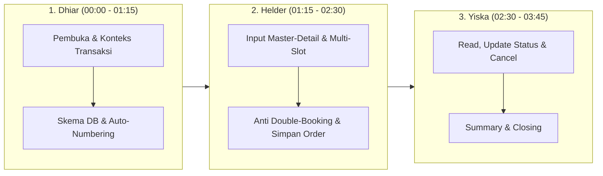

# SIPELA — Sistem Informasi Pemesanan Lapangan Arung Futsal

> **Tugas Kelompok (Group Assignment) — Week 11: Transactional Form (Master-Detail)**  
> **Mata Kuliah**: Pemrograman Desktop (Semester 3)  
> **Dosen Pengampu**: Tri Luhur Indayanti Sugata, S.ST, M.IM.  
> **Program Studi**: Sistem Informasi / Informatika, UPN "Veteran" Jawa Timur  

---

## 👥 Anggota Kelompok
1. **Dhiaurrahman Rabbani Harianto** (NPM: 25082010042)
2. **Helder Abel Freitas** (NPM: 25082010277)
3. **Ifaliantsoa Shearia Yiska F.** (NPM: 25082010278)

---

## 📌 Ringkasan Proyek & Pemenuhan Tugas Week 11

**SIPELA** (Sistem Informasi Pemesanan Lapangan Arung Futsal) adalah aplikasi desktop berbasis **VB.NET Windows Forms (.NET 10)** dan **MySQL** yang dirancang untuk mendigitalkan operasional penyewaan lapangan futsal pada usaha Arung Futsal (jam operasional 08.00–00.00).

Pada penugasan **Week 11 (Group Assignment)**, kelompok kami telah mengimplementasikan **Form Transaksi (Master-Detail)** yang lengkap, tangguh, dan memenuhi seluruh kriteria rubrik penugasan:

| Kriteria Rubrik Penugasan Week 11 | Implementasi pada SIPELA | Keterangan & Lokasi Berkas |
|:---|:---|:---|
| **1. Form Transaksi Master-Detail** | Form `frmPemesanan` dengan 2 tab: Tab 1 untuk Input Transaksi Master-Detail (Keranjang multi-slot) dan Tab 2 untuk Riwayat & Manajemen Transaksi. | `SIPELA/Forms/frmPemesanan.vb` & `frmPemesanan.Designer.vb` |
| **2. Terhubung ke Database MySQL** | Menggunakan relasi tabel Header `pemesanan`, Detail `detail_pemesanan`, dan tabel transaksi `pembayaran` pada database MySQL `arung_futsal`. | `Database/arung_futsal.sql` & `SIPELA/Modules/ModKoneksi.vb` |
| **3. Operasi CRUD Transaksional Lengkap** | **Create**: Simpan booking multi-slot atomik.<br>**Read**: Tabel riwayat pemesanan terformat + popup rincian slot.<br>**Update**: Ubah status booking & pelunasan pembayaran.<br>**Delete**: Batalkan/hapus booking dengan pelepasan slot jadwal. | `SIPELA/Forms/frmPemesanan.vb` |
| **4. Penomoran Otomatis (Auto-Numbering)** | Format unik harian `BKG-YYYYMMDD-XXXX` untuk booking dan `PAY-YYYYMMDD-XXXX` untuk transaksi pembayaran melalui modul atomik `ModAutoNumber.vb`. | `SIPELA/Modules/ModAutoNumber.vb` |
| **5. Validasi Input & Anti Double-Booking** | Validasi input kosong (nama, no telepon, kasir), validasi keranjang belanja, serta validasi anti-bentrok jadwal (anti double-booking) di keranjang dan di database MySQL. | Metode `ApakahSlotSudahDipesan()` di `frmPemesanan.vb` |
| **6. Perhitungan Otomatis & Down Payment (DP)** | Perhitungan otomatis tarif slot, Grand Total sewa secara realtime, dan estimasi syarat pembayaran minimal Uang Muka / DP sebesar **30%**. Opsi *"Langsung Catat DP Terbayar"* terintegrasi otomatis. | Metode `HitungGrandTotal()` di `frmPemesanan.vb` |
| **7. ComboBox Terhubung Database Master** | ComboBox Lapangan (`cboLapangan`) mengambil data aktif dari tabel `lapangan`. ComboBox Kasir (`cboKasir`) mengambil data dari tabel `users` dan default ke sesi kasir aktif. | `MuatMasterLapangan()` & `MuatKasir()` di `frmPemesanan.vb` |
| **8. Standar Properti Tombol & Icon** | Tombol CRUD dilengkapi icon 16×16 px lokal dengan perataan `ImageAlign = MiddleCenter`, `TextAlign = MiddleRight`, dan `TextImageRelation = ImageBeforeText`. | `SIPELA/Modules/ModUIHelper.vb` |

---

## 🛠️ Persyaratan Sistem & Tech Stack

| Komponen | Spesifikasi / Kebutuhan |
|:---|:---|
| **Sistem Operasi** | Windows 10 / Windows 11 |
| **Framework** | .NET 10.0 Windows Forms (`net10.0-windows`) |
| **Bahasa Pemrograman** | Visual Basic .NET (VB.NET) |
| **Database Server** | MySQL Server 8.0+ / MariaDB (Port default `3306`) |
| **Database Driver** | `MySql.Data` (Connector/NET v26.10.0 via NuGet) |
| **IDE / Tool** | Visual Studio 2022+ / VS Code / .NET CLI (`dotnet`) |

---

## 🚀 Panduan Menjalankan Aplikasi

### 1. Persiapan Database MySQL
Pastikan service MySQL Anda sudah berjalan di `localhost:3306`, lalu import skrip database berikut:
```bash
# Melalui terminal MySQL CLI
mysql -u root -p < "Database/arung_futsal.sql"

# Atau jalankan script migration jenis lantai jika database arung_futsal sudah pernah dibuat sebelumnya:
mysql -u root -p < "Database/migration_jenis_lantai.sql"
```

### 2. Konfigurasi Koneksi (Jika Diperlukan)
Secara default, konfigurasi koneksi berada di file `SIPELA/Modules/ModKoneksi.vb`:
- **Host**: `localhost`
- **Port**: `3306`
- **Database**: `arung_futsal`
- **Username**: `root`
- **Password**: `""` *(kosongkan atau sesuaikan dengan password MySQL lokal Anda)*

### 3. Kompilasi dan Jalankan
Buka command prompt / terminal di folder root repositori, lalu jalankan:
```powershell
dotnet build SIPELA\SIPELA.vbproj
dotnet run --project SIPELA\SIPELA.vbproj
```
Atau buka file `SIPELA\SIPELA.slnx` menggunakan **Visual Studio** dan tekan **F5 (Start Debugging)**.

### 🔑 Akun Demo Pengujian
| Role | Username | Password | Hak Akses |
|:---|:---|:---|:---|
| **Owner** | `owner` | `owner123` | Akses Penuh: Master Lapangan, Master Users, Transaksi Pemesanan, dan Logout |
| **Admin** | `admin` | `admin123` | Akses Operasional: Transaksi Pemesanan, Master Lapangan, dan Logout (Master Users dinonaktifkan) |

---

## 📹 PANDUAN & SKRIP VIDEO DEMONSTRASI (FOKUS TRANSAKSI WEEK 11)

> [!IMPORTANT]
> Sesuai instruksi penugasan kelompok Week 11:
> - **Fokus demonstrasi**: Eksklusif pada fitur baru form transaksi Master-Detail (`frmPemesanan`).
> - **Durasi target**: Singkat & padat (~3 hingga 4 menit, maksimal 5 menit).
> - **Ketentuan kamera**: Seluruh anggota kelompok (**Dhiar, Helder, Yiska**) **wajib on-cam** (wajah tampak di kamera) dan berpartisipasi mendemonstrasikan bagian masing-masing.
> - **Penyampaian Yiska**: Disampaikan dalam **Bahasa Inggris** (*English*) karena merupakan mahasiswa internasional.
> - **Platform submission**: Upload link rekaman video (Google Drive / YouTube Unlisted) ke portal **ILMU2**.

---

### ⏱️ Timeline Pembagian Tugas Video

| No | Pembicara | Alokasi Waktu | Topik Utama (Fokus Fitur Transaksi Baru) |
|:---:|:---|:---:|:---|
| **1** | **Dhiaurrahman Rabbani (Dhiar)** | `00:00 - 01:15`<br>*(1m 15s)* | Pembukaan, Latar Belakang Transaksi Futsal, Skema Database Header-Detail (`pemesanan` & `detail_pemesanan`), dan Penomoran Otomatis Atomik (`BKG-YYYYMMDD-XXXX`). |
| **2** | **Helder Abel Freitas (Helder)** | `01:15 - 02:30`<br>*(1m 15s)* | Demo Tab 1 (Create Master-Detail): ComboBox DB (Kasir & Lapangan), Input Multi-Slot, Validasi Anti Double-Booking, Perhitungan Otomatis (Total & DP 30%), dan Simpan Order Atomik (`MySqlTransaction`). |
| **3** | **Ifaliantsoa Shearia Yiska (Yiska)** | `02:30 - 03:45`<br>*(1m 15s)* | Demo Tab 2 (Read, Update, Delete) *(in English)*: Live Search & Filter, View Detailed Slots, Update Status / Pelunasan, Cancel Booking (Freeing Reserved Slots), and Closing. |



---

### 🎬 Skrip Percakapan Video (Ringkas & Padat)

#### BAGIAN 1: PEMBUKAAN, SKEMA TRANSAKSI, & PENOMORAN OTOMATIS
**Pembicara**: **Dhiaurrahman Rabbani Harianto (Dhiar)**  
**Durasi**: `00:00 - 01:15` (1 menit 15 detik)  
**Tampilan Layar**: On-cam Dhiar + ERD Transaksi / Database Tool (`arung_futsal.sql`) + Code Editor `ModAutoNumber.vb`.

* **(00:00 - 00:25) [Pembukaan & Latar Belakang]**
  > *"Halo Bu Tri Luhur dan rekan-rekan sekalian. Kami dari Kelompok Internasional mata kuliah Pemrograman Desktop: saya Dhiaurrahman Rabbani, rekan saya Helder Abel Freitas, dan Ifaliantsoa Shearia Yiska.*  
  > *Pada video ini, kami mendemonstrasikan implementasi fitur baru penugasan Week 11, yaitu **Form Transaksi Master-Detail Pemesanan Lapangan Futsal (SIPELA)**."*

* **(00:25 - 01:15) [Skema Database Transaksi & Penomoran Atomik]**
  > *(Tampilkan relasi tabel di database)*  
  > *"Untuk menangani transaksi sewa multi-slot, kami merancang 3 tabel terelasi di MySQL:*  
  > *1. `pemesanan` sebagai Header: mencatat kode booking unik, ID kasir, nama pemesan, nomor telepon, total sewa, batas bayar, dan status pemesanan.*  
  > *2. `detail_pemesanan` sebagai Detail: mencatat setiap slot jam lapangan yang dipesan dengan proteksi `UNIQUE KEY uq_slot_aktif` agar tidak terjadi double-booking di level database.*  
  > *3. `pembayaran`: mencatat transaksi uang muka (DP) maupun pelunasan.*  
  > *Kode booking berformat unik `BKG-YYYYMMDD-XXXX` di-generate secara atomik melalui `ModAutoNumber.vb`, dan seluruh proses simpan dilindungi oleh `MySqlTransaction`. Selanjutnya, demo input pemesanan akan dipandu oleh Helder."*

---

#### BAGIAN 2: INPUT TRANSAKSI MASTER-DETAIL, PERHITUNGAN, & ANTI DOUBLE-BOOKING
**Pembicara**: **Helder Abel Freitas (Helder)**  
**Durasi**: `01:15 - 02:30` (1 menit 15 detik)  
**Tampilan Layar**: On-cam Helder + Aplikasi SIPELA (`frmMenuUtama` -> `frmPemesanan` Tab 1).

* **(01:15 - 01:50) [Input Header, ComboBox DB, & Multi-Slot Grid]**
  > *(Buka Menu Utama -> Klik tombol Transaksi Pemesanan)*  
  > *"Terima kasih Dhiar. Saya Helder Abel Freitas. Pada Tab 1 ini, kita menginput pemesanan baru:*  
  > *1. Kode booking terisi otomatis.*  
  > *2. ComboBox Kasir dan Lapangan mengambil data master aktif langsung dari database MySQL.*  
  > *3. Kita isi Nama Pemesan `Budi Santoso` dan No. Telepon `081234567890`.*  
  > *4. Pilih Lapangan A Sintetis, Tanggal Main, dan jam operasional `08:00 - 09:00`. Klik **+ Tambah Slot**. Tarif Rp 100.000 masuk ke keranjang.*  
  > *5. Kita tambahkan slot kedua `09:00 - 10:00`. Di bagian bawah, **Grand Total (Rp 200.000)** dan syarat minimal **DP 30% (Rp 60.000)** terhitung otomatis secara realtime."*

* **(01:50 - 02:30) [Uji Anti Double-Booking & Simpan Order Atomik]**
  > *(Coba klik Tambah Slot yang sama, lalu klik Simpan Order)*  
  > *"Jika kita coba menambahkan slot `08:00 - 09:00` sekali lagi, sistem langsung menolak dengan validasi **Anti Double-Booking**.*  
  > *Sekarang kita centang opsi **'Langsung Catat DP Terbayar'** dengan metode `QRIS`, lalu klik tombol **Simpan Order**.*  
  > *Melalui `MySqlTransaction`, data header, detail slot, dan nomor bukti pembayaran `PAY-YYYYMMDD-XXXX` berhasil tersimpan secara atomik!*  
  > *Selanjutnya, riwayat pemesanan dan update status akan didemonstrasikan oleh Yiska in English."*

---

#### BAGIAN 3: RIWAYAT PEMESANAN, UPDATE STATUS, PEMBATALAN, & CLOSING (ENGLISH SCRIPT)
**Speaker**: **Ifaliantsoa Shearia Yiska F. (Yiska)**  
**Duration**: `02:30 - 03:45` (1 minute 15 seconds)  
**On-Screen Display**: On-cam Yiska + Running SIPELA application (`frmPemesanan` Tab 2: Riwayat Pemesanan).

* **(02:30 - 03:15) [Transaction History, Detailed Breakdown, Update Status & Cancellation]**
  > *(Switch to Tab 2: "Daftar & Riwayat Pemesanan")*  
  > *"Thank you Helder. Hello everyone, my name is Ifaliantsoa Shearia Yiska. In Tab 2, we manage the complete lifecycle of court bookings:*  
  > *1. **Read & Search**: All orders are displayed with formatted currency and timestamps. We can quickly search by booking code, customer name, or filter by status.*  
  > *2. **Read Slot Details**: Selecting Budi's booking and clicking **Lihat Detail Slot** shows the exact courts, dates, operational hours, and active statuses.*  
  > *3. **Update Status / Settlement**: Clicking **Ubah Status** allows the cashier to confirm the remaining balance. Once confirmed, the status updates to **Lunas** (Paid in Full) and a settlement record is automatically saved into the `pembayaran` table.*  
  > *4. **Cancel / Delete (Slot Release)**: Clicking **Batalkan Booking** changes the status to 'Kedaluwarsa' and frees the reserved time slots, making them immediately available for new customers without database conflicts."*

* **(03:15 - 03:45) [Summary of Deliverables & Closing]**
  > *(Show all 3 group members on camera)*  
  > *"To summarize our Week 11 deliverables, our team has successfully implemented:*  
  > *1. A complete Master-Detail transactional form connected to MySQL with full CRUD capabilities.*  
  > *2. Live multi-slot scheduling with robust anti double-booking protection.*  
  > *3. Real-time automatic calculations for total fees and 30% down payment.*  
  > *4. Reliable database transactions ensuring commit and rollback integrity.*  
  > *That concludes our demonstration. Thank you very much for your time and attention!"*

---

## 📁 Struktur Berkas Proyek

```
SIPELA-Sistem-Informasi-Pemesanan-Arung-Futsal/
├── .ai/                                  # Dokumentasi Desain & Rencana (AI Workspace)
│   ├── APP-FLOW.md                       # Diagram alur aplikasi
│   ├── DESIGN.md                         # Spesifikasi detail UI & properti kontrol
│   ├── IMPLEMENTATION-PLAN.md            # Rencana implementasi 9 fase (Week 10 & 11)
│   ├── PRD.md                            # Product Requirements Document
│   └── TRD.md                            # Technical Requirements Document
├── Database/
│   ├── arung_futsal.sql                  # Skrip pembuatan database MySQL lengkap
│   └── migration_jenis_lantai.sql        # Skrip migrasi tabel master jenis_lantai
├── SIPELA/                               # Folder Solusi VB.NET Windows Forms
│   ├── SIPELA.slnx                       # File Solution Visual Studio
│   ├── SIPELA.vbproj                     # Project File (.NET 10 WinForms)
│   ├── ApplicationEvents.vb              # Event startup aplikasi
│   ├── Forms/                            # Form Antarmuka Pengguna
│   │   ├── frmLogin.vb                   # Form Autentikasi Pengguna
│   │   ├── frmLogin.Designer.vb
│   │   ├── frmLogin.resx
│   │   ├── frmMenuUtama.vb               # Form Menu Utama (Role-Based Access)
│   │   ├── frmMenuUtama.Designer.vb
│   │   ├── frmMenuUtama.resx
│   │   ├── frmMasterLapangan.vb          # Form Master Lapangan (CRUD & ComboBox DB)
│   │   ├── frmMasterLapangan.Designer.vb
│   │   ├── frmMasterLapangan.resx
│   │   ├── frmMasterUsers.vb             # Form Master Pengguna (CRUD & SHA-256)
│   │   ├── frmMasterUsers.Designer.vb
│   │   ├── frmMasterUsers.resx
│   │   ├── frmPemesanan.vb               # Form Transaksi Pemesanan (Master-Detail, Multi-Slot)
│   │   ├── frmPemesanan.Designer.vb
│   │   └── frmPemesanan.resx
│   ├── Modules/                          # Modul Logika Bisnis & Koneksi
│   │   ├── ModAutoNumber.vb              # Modul penomoran otomatis via SP & MySqlTransaction
│   │   ├── ModErrorHandler.vb            # Modul penanganan error & logger
│   │   ├── ModKoneksi.vb                 # Modul koneksi database MySQL reusable
│   │   ├── ModSesi.vb                    # Modul state sesi pengguna yang login
│   │   └── ModUIHelper.vb                # Modul icon tombol 16×16 & perataan UI
│   ├── Resources/
│   │   └── Icons/                        # Asset Icon 16×16 px untuk tombol CRUD
│   │       ├── insert.png
│   │       ├── update.png
│   │       ├── delete.png
│   │       ├── clear.png
│   │       └── deactivate.png
│   └── My Project/
│       ├── Application.Designer.vb       # Konfigurasi startup form (frmLogin)
│       └── Application.myapp
├── AGENTS.md                             # Pedoman aturan agen pengembang
└── README.md                             # Dokumentasi proyek & skrip video demo Week 11
```
