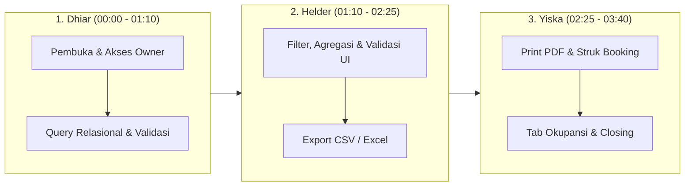

# SIPELA — Sistem Informasi Pemesanan Lapangan Arung Futsal

> **Tugas Kelompok (Group Assignment) — Week 12: Reporting (Laporan Transaksi, Pendapatan, & Okupansi)**  
> **Mata Kuliah**: Pemrograman Desktop (Semester 3)  
> **Dosen Pengampu**: Tri Luhur Indayanti Sugata, S.ST, M.IM.  
> **Program Studi**: Sistem Informasi / Informatika, UPN "Veteran" Jawa Timur  

---

## 👥 Anggota Kelompok
1. **Dhiaurrahman Rabbani Harianto** (NPM: 25082010042)
2. **Helder Abel Freitas** (NPM: 25082010277)
3. **Ifaliantsoa Shearia Yiska F.** (NPM: 25082010278)

---

## 📌 Ringkasan Proyek & Pemenuhan Tugas Week 12

**SIPELA** (Sistem Informasi Pemesanan Lapangan Arung Futsal) adalah aplikasi desktop berbasis **VB.NET Windows Forms (.NET 10)** dan **MySQL** untuk mengelola master data, pemesanan multi-slot, pembayaran DP/pelunasan, serta pelaporan bisnis Arung Futsal (jam operasional 08.00–00.00).

Pada penugasan **Week 12 (Group Assignment — Report)**, kelompok kami telah mengimplementasikan modul pelaporan lengkap pada form **`frmLaporan`** (khusus hak akses **Owner**) yang memenuhi seluruh kriteria rubrik:

| Kriteria Rubrik Penugasan Week 12 | Implementasi pada SIPELA | Lokasi Berkas |
|:---|:---|:---|
| **1. Laporan Berbasis Data Transaksi Sebelumnya** | Form `frmLaporan` dengan **2 Tab**: Tab 1 (*Laporan Transaksi & Pendapatan* dari tabel transaksi Week 11) dan Tab 2 (*Ringkasan Bulanan & Okupansi* dari View `v_laporan_bulanan`). | `SIPELA/Forms/frmLaporan.vb` & `frmLaporan.Designer.vb` |
| **2. Tampilan Data Relasional Terfilter (`DataGridView`)** | Query `JOIN` 5 tabel (`detail_pemesanan`, `pemesanan`, `lapangan`, `users`, dan agregasi `pembayaran`) dengan filter **Jenis Tanggal** (Tanggal Main / Tanggal Pesan), **Rentang Tanggal**, **Lapangan (dari DB)**, **Status**, dan **Kata Kunci**; ditampilkan rapi di `DataGridView`. | `MuatLaporanTransaksi()` di `frmLaporan.vb` |
| **3. Agregasi Data (Summary Metrics)** | 5 kartu ringkasan otomatis di Tab 1 (**Total Booking**, **Total Slot Terjual**, **Grand Total Nilai Sewa**, **Total Pembayaran Masuk**, **Sisa Belum Lunas** — bebas *double-counting* multi-slot) serta 4 kartu ringkasan di Tab 2 (**Total Pendapatan**, **Total Transaksi**, **Total Slot Terisi**, **Rata-rata Okupansi %**). | `HitungAgregasiTransaksi()` & `HitungAgregasiBulanan()` |
| **4. Ekspor File Eksternal & Dokumen Siap Cetak** | **Hybrid**: Ekspor **CSV / Excel-ready** (UTF-8 BOM + metadata + ringkasan agregasi) **DAN** Pratinjau Cetak / **Save to PDF** (`PrintDocument` + `PrintPreviewDialog`) untuk Laporan Transaksi (Landscape multi-halaman), **Struk / Invoice Booking Terpilih** (dinamis per `kode_booking`), dan Ringkasan Bulanan. | `btnExportCsv_Click`, `btnCetakLaporan_Click`, `btnCetakStruk_Click` |
| **5. Validasi Input & Error Handling** | Validasi rentang tanggal (`Dari <= Sampai`), helper konversi *null-safe* (`DBNull`), penanganan hasil pencarian kosong tanpa *crash* (otomatis menonaktifkan tombol ekspor/cetak), proteksi `IOException` saat menulis CSV, serta pembatasan akses khusus **Owner**. | `frmLaporan.vb`, `frmMenuUtama.vb`, `ModErrorHandler.vb` |

---

## 🛠️ Persyaratan Sistem & Tech Stack

| Komponen | Spesifikasi / Kebutuhan |
|:---|:---|
| **Sistem Operasi** | Windows 10 / Windows 11 |
| **Framework** | .NET 10.0 Windows Forms (`net10.0-windows`) |
| **Bahasa Pemrograman** | Visual Basic .NET (VB.NET) |
| **Database Server** | MySQL Server 8.0+ / MariaDB (Port default `3306`) |
| **Database Driver** | `MySql.Data` (Connector/NET v26.10.0 via NuGet) |
| **Reporting & Export** | `System.Drawing.Printing.PrintDocument` + `PrintPreviewDialog` + Native UTF-8 BOM CSV |

---

## 🚀 Panduan Menjalankan Aplikasi

### 1. Persiapan Database MySQL
Pastikan service MySQL berjalan di `localhost:3306`, lalu import skrip database:
```bash
mysql -u root -p < "Database/arung_futsal.sql"
```

### 2. Kompilasi dan Jalankan
```powershell
dotnet build SIPELA\SIPELA.vbproj
dotnet run --project SIPELA\SIPELA.vbproj
```
Atau buka `SIPELA\SIPELA.slnx` di **Visual Studio** lalu tekan **F5**.

### 🔑 Akun Demo Pengujian
| Role | Username | Password | Hak Akses |
|:---|:---|:---|:---|
| **Owner** | `owner` | `owner123` | Akses Penuh: Master Lapangan, Master Users, Transaksi Pemesanan, **Laporan Pendapatan & Okupansi**, dan Logout |
| **Admin** | `admin` | `admin123` | Akses Operasional: Master Lapangan, Transaksi Pemesanan, dan Logout *(Master Users & Laporan dinonaktifkan)* |

---

## 📹 PANDUAN & SKRIP VIDEO DEMONSTRASI (FOKUS LAPORAN WEEK 12)

> [!IMPORTANT]
> Ketentuan video demonstrasi Week 12:
> - **Fokus materi**: Eksklusif pada fitur baru **Form Laporan (`frmLaporan`)** Week 12.
> - **Durasi target**: Singkat & padat (~3 hingga 3,5 menit, maksimal 5 menit).
> - **Ketentuan kamera**: Seluruh anggota kelompok (**Dhiar, Helder, Yiska**) **wajib on-cam**.
> - **Penyampaian Yiska**: Dalam **Bahasa Inggris** (*English*) karena merupakan mahasiswa internasional.

---

### ⏱️ Timeline Pembagian Tugas Video

| No | Pembicara | Alokasi Waktu | Fokus Materi (Hanya Fitur Laporan Week 12) |
|:---:|:---|:---:|:---|
| **1** | **Dhiaurrahman Rabbani (Dhiar)** | `00:00 - 01:10`<br>*(1m 10s)* | Pembukaan, Hak Akses Khusus Owner, Query Relasional 5 Tabel + View `v_laporan_bulanan`, serta Validasi & Null-Safe Error Handling. |
| **2** | **Helder Abel Freitas (Helder)** | `01:10 - 02:25`<br>*(1m 15s)* | Demo Tab 1 (`frmLaporan`): Filter Relasional & Validasi Tanggal, Data Kosong Aman, 5 Kartu Agregasi Realtime, dan Export CSV / Excel. |
| **3** | **Ifaliantsoa Shearia Yiska (Yiska)** | `02:25 - 03:40`<br>*(1m 15s)* | Demo Printable Reports & Tab 2 *(in English)*: Print Preview / PDF Report, Dynamic Booking Invoice (`Cetak Struk Booking`), Monthly Revenue & Occupancy (`v_laporan_bulanan`), and Closing. |



---

### 🎬 Skrip Percakapan Video (Ringkas & Padat)

#### BAGIAN 1: PEMBUKAAN, HAK AKSES, QUERY RELASIONAL, & VALIDASI
**Pembicara**: **Dhiaurrahman Rabbani Harianto (Dhiar)**  
**Durasi**: `00:00 - 01:10` (1 menit 10 detik)  
**Tampilan Layar**: On-cam Dhiar + Demo Role Access (`frmMenuUtama`) + Kode `frmLaporan.vb` (query JOIN & helper null-safe).

* **(00:00 - 00:25) [Pembukaan & Hak Akses Khusus Owner]**
  > *"Halo Bu Tri Luhur dan rekan-rekan. Kami dari Kelompok Internasional Pemrograman Desktop: saya Dhiaurrahman Rabbani, Helder Abel Freitas, dan Ifaliantsoa Shearia Yiska.*  
  > *Pada video ini, kami mendemonstrasikan fitur baru Week 12 pada **SIPELA**, yaitu **Form Laporan Pendapatan, Transaksi, & Okupansi (`frmLaporan`)** yang hanya dapat diakses oleh **Owner** — sementara pada akun Admin tombol Laporan otomatis dinonaktifkan."*

* **(00:25 - 01:10) [Query Relasional, View Okupansi, & Error Handling]**
  > *(Tampilkan sekilas kode query & helper di `frmLaporan.vb`)*  
  > *"Secara teknis, Tab 1 menggabungkan 5 tabel transaksi Week 11 (`detail_pemesanan`, `pemesanan`, `lapangan`, `users`, dan agregasi `pembayaran`) menggunakan parameterized query. Tab 2 memanfaatkan database View `v_laporan_bulanan` lengkap dengan fallback query.*  
  > *Untuk mencegah crash, kami menambahkan validasi rentang tanggal, helper konversi null-safe untuk `DBNull`, serta kalkulasi berbasis `HashSet` agar pembayaran pada booking multi-slot tidak terhitung ganda. Selanjutnya, demo filter, agregasi, dan ekspor CSV akan dibawakan oleh Helder."*

---

#### BAGIAN 2: FILTER RELASIONAL, AGREGASI METRIK, & EXPORT CSV / EXCEL
**Pembicara**: **Helder Abel Freitas (Helder)**  
**Durasi**: `01:10 - 02:25` (1 menit 15 detik)  
**Tampilan Layar**: On-cam Helder + Aplikasi SIPELA (`frmLaporan` Tab 1) + Hasil file CSV di Excel.

* **(01:10 - 01:50) [Demo Filter, Validasi Error, & Kartu Agregasi]**
  > *(Login sebagai Owner -> Klik tombol Laporan Pendapatan & Okupansi)*  
  > *"Terima kasih Dhiar. Saya Helder Abel Freitas. Pada Tab 1 **Laporan Transaksi & Pendapatan**, DataGridView langsung menampilkan data relasional hasil transaksi Week 11.*  
  > *Kita bisa memfilter berdasarkan Tanggal Main atau Tanggal Pesan, rentang tanggal, ComboBox Lapangan dari database, status pemesanan, maupun pencarian kata kunci.*  
  > *Jika kita masukkan tanggal awal lebih besar dari tanggal akhir, sistem menampilkan peringatan validasi tanpa crash. Jika hasil pencarian kosong, kartu ringkasan otomatis di-reset ke 0 dan tombol ekspor/cetak dinonaktifkan.*  
  > *Saat filter valid, 5 kartu agregasi langsung menghitung **Total Booking**, **Total Slot**, **Grand Total Nilai Sewa**, **Total Pembayaran Masuk**, dan **Sisa Belum Lunas**."*

* **(01:50 - 02:25) [Demo Export CSV / Excel]**
  > *(Klik tombol **Export CSV / Excel** -> simpan -> buka sekilas file CSV)*  
  > *"Sekarang kita klik **Export CSV / Excel**. File tersimpan dalam format UTF-8 BOM sehingga saat dibuka di Microsoft Excel, kolom tabel, metadata filter, dan blok ringkasan agregasi langsung tersusun rapi.*  
  > *Selanjutnya, demo cetak dokumen PDF, Struk Booking, dan Ringkasan Bulanan akan dijelaskan oleh Yiska in English."*

---

#### BAGIAN 3: PRINT PREVIEW / PDF, STRUK BOOKING, OKUPANSI BULANAN, & CLOSING (ENGLISH SCRIPT)
**Speaker**: **Ifaliantsoa Shearia Yiska F. (Yiska)**  
**Duration**: `02:25 - 03:40` (1 minute 15 seconds)  
**On-Screen Display**: On-cam Yiska + Running SIPELA (`frmLaporan` Print Preview, Booking Invoice, & Tab 2).

* **(02:25 - 03:15) [Print Preview / PDF, Dynamic Booking Invoice, & Monthly Occupancy Tab]**
  > *(Click **Cetak / PDF Laporan**, then select a row and click **Cetak Struk Booking**, then switch to Tab 2)*  
  > *"Thank you Helder. Hello everyone, I am Ifaliantsoa Shearia Yiska. Besides CSV export, SIPELA provides built-in printable documents:*  
  > *1. **Transaction Report Preview**: Clicking **Cetak / PDF Laporan** opens a formatted Landscape preview with automatic multi-page pagination and summary totals, ready to print or save as PDF.*  
  > *2. **Dynamic Booking Invoice**: Selecting any transaction and clicking **Cetak Struk Booking** dynamically generates a complete receipt for that booking code, showing customer info, all reserved court slots, payment history, and remaining balance.*  
  > *3. **Monthly Summary & Occupancy (Tab 2)**: Switching to Tab 2 displays monthly revenue, transaction counts, filled slots, and occupancy percentage from `v_laporan_bulanan`, complete with year filtering, CSV export, and PDF print preview."*

* **(03:15 - 03:40) [Week 12 Summary & Closing]**
  > *(Show all 3 members on camera)*  
  > *"To wrap up Week 12, our team has successfully delivered an Owner-only relational reporting module with dynamic filtering, accurate summary aggregations, Excel-ready CSV export, printable PDF reports & invoices, and robust input validation.*  
  > *Thank you very much for watching!"*

---

## 📁 Struktur Berkas Proyek

```
SIPELA-Sistem-Informasi-Pemesanan-Arung-Futsal/
├── .ai/                                  # Dokumentasi Desain & Rencana (AI Workspace)
│   ├── APP-FLOW.md                       # Diagram alur aplikasi (Week 10–12)
│   ├── DESIGN.md                         # Spesifikasi detail UI & properti kontrol
│   ├── IMPLEMENTATION-PLAN.md            # Rencana implementasi 10 fase (Week 10–12)
│   ├── PRD.md                            # Product Requirements Document
│   └── TRD.md                            # Technical Requirements Document
├── Database/
│   ├── arung_futsal.sql                  # Skrip database MySQL lengkap (tabel, SP, views, seed)
│   └── migration_jenis_lantai.sql        # Skrip migrasi tabel master jenis_lantai
├── SIPELA/                               # Folder Solusi VB.NET Windows Forms
│   ├── SIPELA.slnx                       # File Solution Visual Studio
│   ├── SIPELA.vbproj                     # Project File (.NET 10 WinForms)
│   ├── ApplicationEvents.vb              # Event startup aplikasi
│   ├── Forms/                            # Form Antarmuka Pengguna (Designer-ready)
│   │   ├── frmLogin.{vb,Designer.vb,resx}
│   │   ├── frmMenuUtama.{vb,Designer.vb,resx}
│   │   ├── frmMasterLapangan.{vb,Designer.vb,resx}
│   │   ├── frmMasterUsers.{vb,Designer.vb,resx}
│   │   ├── frmPemesanan.{vb,Designer.vb,resx}
│   │   └── frmLaporan.{vb,Designer.vb,resx}
│   ├── Modules/                          # Modul Logika Bisnis & Koneksi
│   │   ├── ModAutoNumber.vb              # Penomoran otomatis atomik via SP & MySqlTransaction
│   │   ├── ModErrorHandler.vb            # Penanganan error & logger
│   │   ├── ModKoneksi.vb                 # Koneksi database MySQL reusable
│   │   ├── ModSesi.vb                    # State sesi & role pengguna aktif
│   │   └── ModUIHelper.vb                # Icon tombol 16×16 & perataan UI
│   ├── Resources/Icons/                  # Asset Icon 16×16 px untuk tombol CRUD
│   └── My Project/
│       ├── Application.Designer.vb       # Startup form (frmLogin)
│       └── Application.myapp
├── AGENTS.md                             # Pedoman aturan agen pengembang
└── README.md                             # Dokumentasi proyek & skrip video demo Week 12
```
