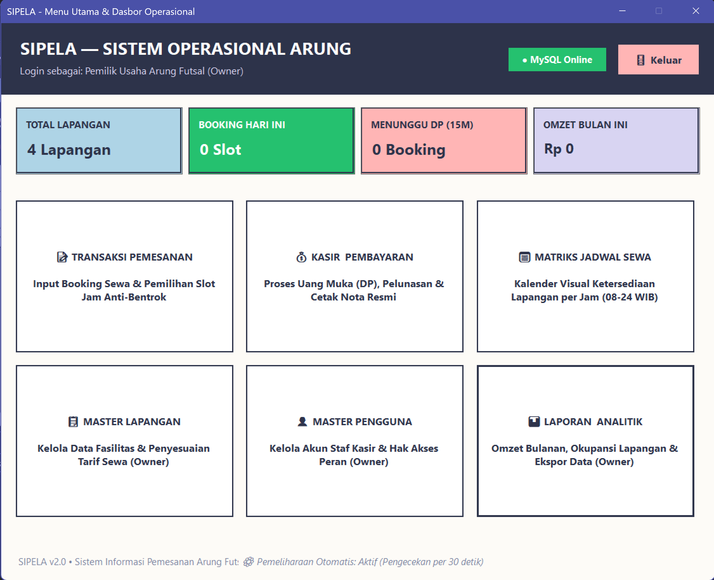
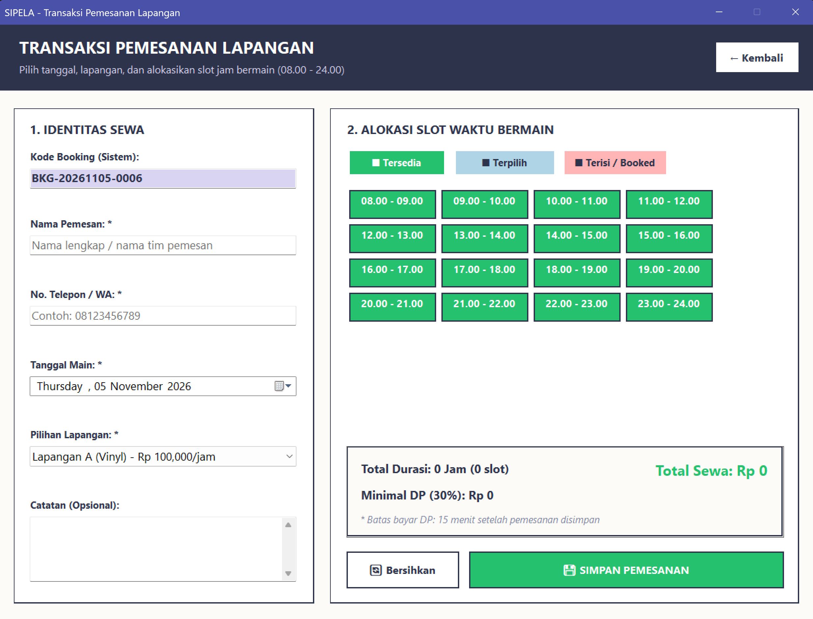
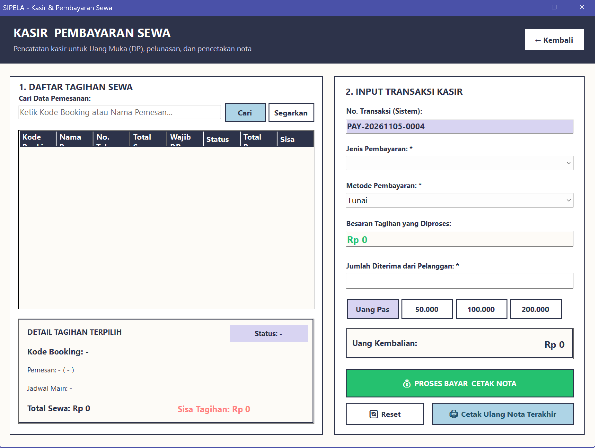

# SIPELA — Sistem Informasi Pemesanan Arung Futsal

**SIPELA** adalah aplikasi kasir & pemesanan lapangan futsal berbasis **VB.NET Windows Forms (.NET 10)** dengan database **MySQL**. Sistem memusatkan rantai operasional harian kasir dan manajemen pemilik: dari pencatatan pemesanan slot waktu 08.00–24.00, pemrosesan DP & pelunasan, cetak struk, kalender matriks jadwal, hingga laporan analitik pendapatan & okupansi.

- **Mata Kuliah**: Pemrograman Desktop — Semester 3 (UPN "Veteran" Jawa Timur)
- **Tema UI**: Tactile Claymorphism + Neo-Brutalism
- **Dokumentasi lengkap**: lihat folder [`.ai/`](.ai/) (PRD, TRD, DESIGN, APP-FLOW, IMPLEMENTATION-PLAN)

---

## Tangkapan Layar

| | |
|---|---|
|  |  |
| **Halaman Utama Admin** — dashboard taktil & navigasi operasional | **Form Pemesanan** — input pemesan & visual slot picker jam |
|  | |
| **Daftar Sewa** — rekap pemesanan / jadwal lapangan | |

---

## Fitur Utama

| Modul | Deskripsi |
|-------|-----------|
| **Autentikasi & Sesi** | Login hash SHA-256, deteksi brute-force (kunci akun 15 menit setelah 5x gagal), hak akses berbasis peran (Admin / Owner). |
| **Master Lapangan** | Kelola nama lapangan, jenis lantai (vinyl / rumput sintetis), tarif per jam; validasi unik & soft-delete. |
| **Master Users** | Kelola akun staf kasir & pemilik oleh Owner; proteksi penghapusan akun sendiri. |
| **Pemesanan Lapangan** | Kode booking otomatis `BKG-YYYYMMDD-XXXX`, slot picker visual 08.00–24.00, kalkulasi otomatis total sewa & DP min. 30%, pencegahan *double booking* via constraint `uq_slot_aktif`, transaksi atomik. |
| **Kasir & Pembayaran** | Cari tagihan booking, pembayaran DP & pelunasan, kalkulasi kembalian, no. transaksi `PAY-YYYYMMDD-XXXX`, metode Tunai / QRIS / Transfer, cetak struk resmi. |
| **Kalender Matriks Jadwal** | Grid ketersediaan seluruh lapangan per jam dengan indikator warna (Tersedia / Terisi / Menunggu DP); klik slot kosong → langsung buat pemesanan. |
| **Laporan & Analitik** | Rekap pendapatan bulanan, okupansi lapangan (%), pertumbuhan Month-over-Month (MoM), ekspor CSV (Excel-compatible), cetak rekap resmi. |
| **Auto-Expiration Engine** | Routine background otomatis membatalkan pemesanan yang tidak dibayar dalam batas waktu 15 menit dan melepas slot kembali. |

---

## Tech Stack

| Komponen | Teknologi |
|----------|-----------|
| Runtime | .NET 10 — Windows Desktop (`net10.0-windows`) |
| Bahasa | Visual Basic .NET (WinForms) |
| Database | MySQL 8.0 / MariaDB (InnoDB) |
| Connector | `MySql.Data` v26.10.0 |
| Keamanan | SHA-256 hashing, parameterized queries |
| Cetak | `System.Drawing.Printing` (struk & laporan) |

---

## Struktur Proyek

```
SIPELA-Sistem-Informasi-Pemesanan-Arung-Futsal/
├── .ai/                  # Dokumentasi sistem (PRD, TRD, DESIGN, APP-FLOW, IMPLEMENTATION-PLAN)
├── .agents/skills/       # Agent skills (dotnet-best-practices, find-skills, 9router, herdr)
├── Database/
│   ├── arung_futsal.sql                  # Skrip skema lengkap (tabel, SP, view, seed)
│   └── migration_v2_views_procedures.sql # Migrasi v2 views & SP (re-runable)
├── pics/                 # Tangkapan layar aplikasi
├── SIPELA/
│   ├── SIPELA.slnx       # Solution file
│   ├── SIPELA.vbproj     # Project .NET 10 WinForms
│   ├── Forms/            # frmLogin, frmMenuUtama, frmPemesanan, frmPembayaran,
│   │                     # frmJadwal, frmLaporan, frmMasterLapangan, frmMasterUsers, frmNotaPreview
│   └── Modules/          # ModKoneksi, ModSesi, ModErrorHandler, ModAutoNumber, ModUIHelper
└── AGENTS.md             # Aturan interaksi & eksekusi agen
```

---

## Cara Menjalankan

1. **Import database**: buat skema `arung_futsal`, jalankan `Database/arung_futsal.sql`, lalu `Database/migration_v2_views_procedures.sql`.
2. **Buka solusi**: buka `SIPELA/SIPELA.slnx` dengan Visual Studio 2026+ (atau IDE pendukung .NET 10).
3. **Build & run**: pastikan string koneksi di `ModKoneksi.vb` sesuai environment MySQL Anda, lalu jalankan.

### Akun Demo (seed)

| Username | Password | Role |
|----------|----------|------|
| `owner` | `owner123` | Owner (akses penuh) |
| `admin` | `admin123` | Admin / Kasir |

---

## Catatan Implementasi

- Seluruh fase operasional inti (Fase 9 s.d. 15) telah selesai — lihat rincian & arsip di [`.ai/IMPLEMENTATION-PLAN.md`](.ai/IMPLEMENTATION-PLAN.md).
- ⚠️ **Bug terbuka**: laporan analitik jenis *Ringkasan Bulanan* gagal dengan error `only_full_group_by` pada view `v_okupansi_bulanan` (ditelusuri sebagai BUG-001, arah fix sudah terdokumentasi di plan — dikerjakan di iterasi berikutnya).
