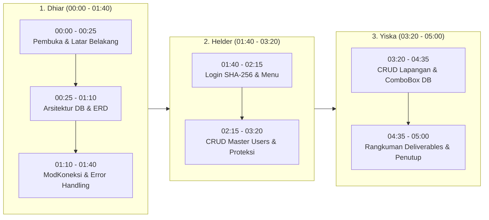

# SIPELA — Sistem Informasi Pemesanan Lapangan Arung Futsal

> **Tugas Kelompok (Group Assignment) — Week 10: Database & Master Form**  
> **Mata Kuliah**: Pemrograman Desktop (Semester 3)  
> **Dosen Pengampu**: Tri Luhur Indayanti Sugata, S.ST, M.IM.  
> **Program Studi**: Sistem Informasi / Informatika, UPN "Veteran" Jawa Timur  

---

## 👥 Anggota Kelompok
1. **Dhiaurrahman Rabbani Harianto** (NPM: 25082010042)
2. **Helder Abel Freitas** (NPM: 25082010277)
3. **Ifaliantsoa Shearia Yiska F.** (NPM: 25082010278)

---

## 📌 Ringkasan Proyek

**SIPELA** (Sistem Informasi Pemesanan Lapangan Arung Futsal) adalah aplikasi desktop berbasis **VB.NET Windows Forms (.NET 10)** dan **MySQL** yang dirancang untuk mendigitalkan operasional penyewaan lapangan futsal pada usaha Arung Futsal (jam operasional 08.00–00.00).

Pada penugasan **Week 10 (Group Assignment)**, kelompok kami telah mengimplementasikan seluruh kebutuhan rubrik penilaian:
1. **Database Design & Implementation**: Skrip MySQL lengkap (`arung_futsal.sql`) dengan struktur tabel, relasi PK & FK, constraint data, stored procedure, view agregasi, dan sample seed data.
2. **Database Migration Pendukung**: Skrip `migration_jenis_lantai.sql` untuk tabel master pendukung jenis lantai futsal.
3. **Reusable Database Connection**: Modul koneksi terpusat (`ModKoneksi.vb`) dengan validasi koneksi dan error handling terstruktur (`MySqlException`).
4. **Master Data Form 1 — Lapangan (`frmMasterLapangan`)**: CRUD lengkap (Insert, Update, Nonaktifkan/Soft Delete, Delete/Hard Delete dengan proteksi integritas FK, Clear), DataGridView terformat, pencarian realtime, dan ComboBox jenis lantai yang **terhubung langsung ke database MySQL**.
5. **Master Data Form 2 — Users (`frmMasterUsers`)**: CRUD lengkap akun pengguna, enkripsi password hash **SHA-256**, ComboBox pilihan role (Owner/Admin), sensor kolom password di DataGridView, proteksi hapus akun yang sedang login, dan proteksi hapus akun dengan riwayat transaksi.
6. **Form Autentikasi & Navigasi**: `frmLogin` (autentikasi SHA-256 + proteksi brute-force lock) dan `frmMenuUtama` (menu role-based access).
7. **Standar Properti Tombol & Icon**: Seluruh tombol CRUD pada form master dilengkapi icon PNG 16×16 px lokal dengan perataan `ImageAlign = MiddleCenter`, `TextAlign = MiddleRight`, dan `TextImageRelation = ImageBeforeText`.

---

## 🛠️ Persyaratan Sistem & Tech Stack

| Komponen | Spesifikasi / Kebutuhan |
|:---|:---|
| **Sistem Operasi** | Windows 10 / Windows 11 |
| **Framework** | .NET 10.0 Windows Forms (`net10.0-windows`) |
| **Bahasa Pemrograman** | Visual Basic .NET (VB.NET) |
| **Database Server** | MySQL Server 8.0+ / MariaDB (Port default `3306`) |
| **Database Driver** | `MySql.Data` (Connector/NET v26.10.0 via NuGet) |
| **IDE / Tool** | Visual Studio 2022+ / VS Code / .NET CLI (`dotnet`) |

---

## 🚀 Panduan Menjalankan Aplikasi

### 1. Persiapan Database MySQL
Pastikan service MySQL Anda sudah berjalan di `localhost:3306`, lalu import skrip database berikut:
```bash
# Melalui terminal MySQL CLI
mysql -u root -p < "Database/arung_futsal.sql"

# Atau jalankan script migration jenis lantai jika database arung_futsal sudah pernah dibuat sebelumnya:
mysql -u root -p < "Database/migration_jenis_lantai.sql"
```
*(Anda juga dapat membuka dan mengeksekusi file `Database/arung_futsal.sql` langsung melalui aplikasi GUI seperti HeidiSQL, DBeaver, Navicat, atau phpMyAdmin).*

### 2. Konfigurasi Koneksi (Jika Diperlukan)
Secara default, konfigurasi koneksi berada di file `SIPELA/Modules/ModKoneksi.vb`:
- **Host**: `localhost`
- **Port**: `3306`
- **Database**: `arung_futsal`
- **Username**: `root`
- **Password**: `""` *(kosongkan atau sesuaikan dengan password MySQL lokal Anda)*

### 3. Kompilasi dan Jalankan
Buka command prompt / terminal di folder root repositori, lalu jalankan:
```powershell
dotnet build SIPELA\SIPELA.vbproj
dotnet run --project SIPELA\SIPELA.vbproj
```
Atau buka file `SIPELA\SIPELA.slnx` menggunakan **Visual Studio** dan tekan **F5 (Start Debugging)**.

### 🔑 Akun Demo Pengujian
| Role | Username | Password | Hak Akses |
|:---|:---|:---|:---|
| **Owner** | `owner` | `owner123` | Akses Penuh: Master Lapangan, Master Users, dan Logout |
| **Admin** | `admin` | `admin123` | Akses Operasional: Master Lapangan dan Logout (Master Users dinonaktifkan) |

---

## 📹 PANDUAN & SKRIP VIDEO DEMONSTRASI (MAKSIMAL 5 MENIT)

> [!IMPORTANT]
> Sesuai instruksi penugasan Week 10:
> - **Durasi maksimal**: 5 menit.
> - **Ketentuan kamera**: Seluruh anggota kelompok (**Dhiar, Helder, Yiska**) **wajib on-cam** (wajah tampak di kamera) dan berpartisipasi menjelaskan/mendemonstrasikan kontribusi masing-masing.
> - **Platform submission**: Upload link rekaman video (Google Drive / YouTube Unlisted) ke portal **ILMU2**.

---

### ⏱️ Timeline Pembagian Tugas Video

| No | Pembicara | Alokasi Waktu | Topik Utama yang Dibahas |
|:---:|:---|:---:|:---|
| **1** | **Dhiaurrahman Rabbani (Dhiar)** | `00:00 - 01:40`<br>*(1m 40s)* | Pembukaan, Latar Belakang Kasus Arung Futsal, Struktur Database & ERD, Modul Koneksi Reusable `ModKoneksi.vb`, dan Penanganan Error. |
| **2** | **Helder Abel Freitas (Helder)** | `01:40 - 03:20`<br>*(1m 40s)* | Demo Login (SHA-256 Hash & Brute-Force Lock), Role-Based Menu Navigasi, Demo CRUD Master Users (Insert, Update, Soft/Hard Delete, Proteksi Akun). |
| **3** | **Ifaliantsoa Shearia Yiska (Yiska)** | `03:20 - 05:00`<br>*(1m 40s)* | Master Lapangan Demo (CRUD, Database-driven ComboBox, Validation, Soft & Hard Delete with FK integrity check), and Week 10 Deliverables Summary Closing *(in English)*. |



---

### 🎬 Skrip Detail Percakapan Menit-per-Menit

#### BAGIAN 1: PEMBUKAAN, DATABASE, & MODUL KONEKSI
**Pembicara**: **Dhiaurrahman Rabbani Harianto (Dhiar)**  
**Durasi**: `00:00 - 01:40` (1 menit 40 detik)  
**Tampilan Layar**: Kamera on-cam Dhiar + Presentasi ERD & Skrip SQL (`arung_futsal.sql`) + Code Editor `ModKoneksi.vb`.

* **(00:00 - 00:25) [Pembukaan & Studi Kasus]**
  > *"Halo semuanya! Selamat pagi/siang kepada Bu Tri Luhur dan rekan-rekan sekalian. Kami dari Kelompok Internasional mata kuliah Pemrograman Desktop akan mendemonstrasikan hasil pengerjaan Group Assignment Week 10: Database & Master Form.*  
  > *Anggota kelompok kami terdiri dari saya sendiri Dhiaurrahman Rabbani, rekan saya Helder Abel Freitas, dan Ifaliantsoa Shearia Yiska.*  
  > *Studi kasus yang kami angkat adalah **SIPELA — Sistem Informasi Pemesanan Lapangan Arung Futsal**, sebuah solusi desktop untuk mengelola jadwal sewa, reservasi, dan transaksi lapangan futsal secara terpusat."*

* **(00:25 - 01:10) [Database Implementation & ERD]**
  > *(Tampilkan database di HeidiSQL/DBeaver atau diagram ERD)*  
  > *"Pada bagian database, kami telah merancang database MySQL `arung_futsal` yang terdiri dari 7 tabel utama:*  
  > *1. Tabel `users` untuk manajemen akun dan hak akses.*  
  > *2. Tabel `jenis_lantai` sebagai tabel master pendukung jenis lapangan.*  
  > *3. Tabel `lapangan` dengan constraint harga positif dan soft-delete.*  
  > *4. Tabel `pemesanan` dan `detail_pemesanan` yang memiliki composite unique key untuk mencegah double-booking.*  
  > *5. Serta tabel `pembayaran` dan `penomoran`.*  
  > *Seluruh relasi telah menerapkan Primary Key dan Foreign Key dengan aturan `ON DELETE RESTRICT` untuk menjaga integritas data transaksi."*

* **(01:10 - 01:40) [Modul Koneksi Reusable & Error Handling]**
  > *(Tampilkan kode `ModKoneksi.vb` di Visual Studio)*  
  > *"Untuk menghubungkan aplikasi VB.NET ke MySQL, kami membuat modul reusable `ModKoneksi.vb` menggunakan package `MySql.Data`. Modul ini mengkapsulasi fungsi `BukaKoneksi()` dan `TestKoneksi()`. Jika koneksi database terputus atau server MySQL belum aktif, sistem secara otomatis menangkap exception `MySqlException` dan menampilkan pesan error yang informatif kepada pengguna melalui `ModErrorHandler` tanpa menyebabkan aplikasi crash.*  
  > *Selanjutnya, demonstrasi form login dan Master Users akan dilanjutkan oleh rekan saya, Helder."*

---

#### BAGIAN 2: LOGIN AUTHENTICATION & MASTER DATA USERS
**Pembicara**: **Helder Abel Freitas (Helder)**  
**Durasi**: `01:40 - 03:20` (1 menit 40 detik)  
**Tampilan Layar**: Kamera on-cam Helder + Aplikasi SIPELA Running (`frmLogin`, `frmMenuUtama`, `frmMasterUsers`).

* **(01:40 - 02:15) [Demo Login & Hak Akses Menu]**
  > *(Jalankan aplikasi, tampilkan `frmLogin`)*  
  > *"Terima kasih Dhiar. Saya Helder Abel Freitas. Sekarang kita akan melihat implementasi autentikasi pengguna pada form login.*  
  > *Di SIPELA, seluruh password disimpan menggunakan enkripsi hashing **SHA-256** dan tidak pernah disimpan dalam bentuk plaintext. Selain itu, kami menerapkan proteksi brute-force: jika pengguna salah memasukkan password sebanyak 5 kali berturut-turut, akun akan terkunci otomatis selama 15 menit.*  
  > *Mari kita coba login sebagai akun `owner` dengan password `owner123`.*  
  > *(Klik Login -> Masuk ke Menu Utama).*  
  > *Saat login sebagai Owner, seluruh fitur master terbuka penuh. Namun jika login sebagai Admin, tombol Master Users akan dinonaktifkan sesuai prinsip Role-Based Access Control."*

* **(02:15 - 03:20) [Demo CRUD Master Users]**
  > *(Buka menu Master Users -> `frmMasterUsers`)*  
  > *"Sekarang kita masuk ke Form Master Users. Di sini seluruh data pengguna ditampilkan di DataGridView, di mana kolom sensitif seperti hash password disembunyikan demi keamanan.*  
  > *Mari kita uji operasi CRUD-nya:*  
  > *1. **Insert (Tambah Data)**: Kita masukkan username `kasir1`, password `kasir123`, nama lengkap `Kasir Pagi`, dan pilih Role `Admin` dari ComboBox. Klik tombol **Insert** (dengan icon 16x16 px). Data berhasil masuk ke MySQL dan grid langsung ter-refresh.*  
  > *2. **Read & Update (Ubah Data)**: Saat baris `kasir1` kita klik di DataGridView, form input terisi otomatis. Kita ubah nama lengkapnya menjadi `Kasir Senior`, password kita kosongkan agar tetap memakai password lama, lalu klik **Update**. Data berhasil diperbarui.*  
  > *3. **Delete & Proteksi Keamanan**: Kami menyediakan dua jenis penghapusan:*  
  > *- Tombol **Nonaktifkan (Soft Delete)** untuk menonaktifkan status akun tanpa menghapus histori.*  
  > *- Tombol **Delete (Hard Delete)** untuk menghapus akun permanen dari database.*  
  > *Sistem juga memiliki proteksi cerdas: kita tidak dapat menghapus akun kita sendiri yang sedang aktif login, dan tidak dapat menghapus user yang memiliki riwayat transaksi pemesanan.*  
  > *4. **Clear & Search**: Tombol Clear membersihkan form kembali ke mode Insert, dan search bar dapat memfilter pengguna secara realtime.*  
  > *Selanjutnya, demonstrasi Master Lapangan dan kesimpulan akan dilanjutkan oleh rekan saya, Yiska. Now, Yiska will take over to demonstrate the Master Lapangan form."*

---

#### BAGIAN 3: MASTER DATA LAPANGAN & CLOSING (ENGLISH SCRIPT)
**Speaker**: **Ifaliantsoa Shearia Yiska F. (Yiska)**  
**Duration**: `03:20 - 05:00` (1 minute 40 seconds)  
**On-Screen Display**: Yiska on-camera + Running SIPELA application (`frmMasterLapangan`) + Closing screen.

* **(03:20 - 04:35) [Master Lapangan Form Demo & Database-Driven ComboBox]**
  > *(Navigate back to menu -> open `frmMasterLapangan`)*  
  > *"Thank you Helder. Hello everyone, my name is Ifaliantsoa Shearia Yiska. Today, I will demonstrate our second master form, which is **Master Data Lapangan (Futsal Fields)**.*  
  > *In accordance with the Week 10 assignment rubric, the `Jenis Lantai` (Floor Type) ComboBox in this form is not hardcoded; instead, it **dynamically retrieves master data directly from the `jenis_lantai` table in our MySQL database**.*  
  > *Let's demonstrate the full CRUD workflow:*  
  > *1. **Input Validation**: If we attempt to click Insert with an empty name or an invalid price, the system immediately displays informative validation warnings.*  
  > *2. **Insert**: Let's input the field name as `Lapangan D Outdoor`, select the floor type `Interlock` loaded from the database, set the hourly rate to Rp 90,000, and click the **Insert** button (equipped with our 16x16 icon). The record is stored in MySQL and immediately displayed on our DataGridView.*  
  > *3. **Duplicate Prevention**: If we attempt to insert another field with the exact same name, our unique constraint detection blocks the operation and warns us.*  
  > *4. **Read & Update**: Clicking any row in the DataGridView automatically populates all input fields. Let's update the rate to Rp 95,000 and click **Update**. The record updates instantly.*  
  > *5. **Soft Delete vs. Hard Delete**:*  
  > *- If we click **Nonaktifkan (Soft Delete)**, the field status is toggled to inactive, preserving historical booking records.*  
  > *- If we click **Delete (Hard Delete)**, our system verifies foreign key integrity against the `detail_pemesanan` table. If the field already has associated booking transactions, the permanent delete is rejected to protect data integrity; otherwise, if there are no linked records, it is safely removed from the database.*  
  > *6. **Real-time Search**: We can type in the search bar to filter field names and floor types instantly."*

* **(04:35 - 05:00) [Summary of Deliverables & Closing]**
  > *(Show all 3 group members on camera)*  
  > *"To summarize our Week 10 deliverables, our team has successfully implemented:*  
  > *1. A comprehensive MySQL database with full constraints, primary keys, and foreign keys.*  
  > *2. A reusable database connection module with robust error handling.*  
  > *3. Two fully functional master data forms featuring standard Windows Forms controls, 16×16 px icons, database-bound ComboBoxes, and complete CRUD operations.*  
  > *That concludes our group presentation and demonstration. Thank you very much for your time and attention. Have a great day!"*

---

## 📁 Struktur Berkas Proyek

```
SIPELA-Sistem-Informasi-Pemesanan-Arung-Futsal/
├── .ai/                                  # Dokumentasi Desain & Rencana (AI Workspace)
│   ├── APP-FLOW.md                       # Diagram alur aplikasi
│   ├── DESIGN.md                         # Spesifikasi detail UI & properti kontrol
│   ├── IMPLEMENTATION-PLAN.md            # Rencana implementasi 8 fase
│   ├── PRD.md                            # Product Requirements Document
│   └── TRD.md                            # Technical Requirements Document
├── Database/
│   ├── arung_futsal.sql                  # Skrip pembuatan database MySQL lengkap
│   └── migration_jenis_lantai.sql        # Skrip migrasi tabel master jenis_lantai
├── SIPELA/                               # Folder Solusi VB.NET Windows Forms
│   ├── SIPELA.slnx                       # File Solution Visual Studio
│   ├── SIPELA.vbproj                     # Project File (.NET 10 WinForms)
│   ├── ApplicationEvents.vb              # Event startup aplikasi
│   ├── Forms/                            # Form Antarmuka Pengguna
│   │   ├── frmLogin.vb                   # Form Autentikasi Pengguna
│   │   ├── frmLogin.Designer.vb
│   │   ├── frmMenuUtama.vb               # Form Menu Utama (Role-Based Access)
│   │   ├── frmMenuUtama.Designer.vb
│   │   ├── frmMasterLapangan.vb          # Form Master Lapangan (CRUD & ComboBox DB)
│   │   ├── frmMasterLapangan.Designer.vb
│   │   ├── frmMasterUsers.vb             # Form Master Pengguna (CRUD & SHA-256)
│   │   └── frmMasterUsers.Designer.vb
│   ├── Modules/                          # Modul Logika Bisnis & Koneksi
│   │   ├── ModAutoNumber.vb              # Modul penomoran otomatis
│   │   ├── ModErrorHandler.vb            # Modul penanganan error & logger
│   │   ├── ModKoneksi.vb                 # Modul koneksi database MySQL reusable
│   │   ├── ModSesi.vb                    # Modul state sesi pengguna yang login
│   │   └── ModUIHelper.vb                # Modul icon tombol 16×16 & perataan UI
│   ├── Resources/
│   │   └── Icons/                        # Asset Icon 16×16 px untuk tombol CRUD
│   │       ├── insert.png
│   │       ├── update.png
│   │       ├── delete.png
│   │       ├── clear.png
│   │       └── deactivate.png
│   └── My Project/
│       ├── Application.Designer.vb       # Konfigurasi startup form (frmLogin)
│       └── Application.myapp
├── AGENTS.md                             # Pedoman aturan agen pengembang
└── README.md                             # Dokumentasi proyek & skrip video demo
```

